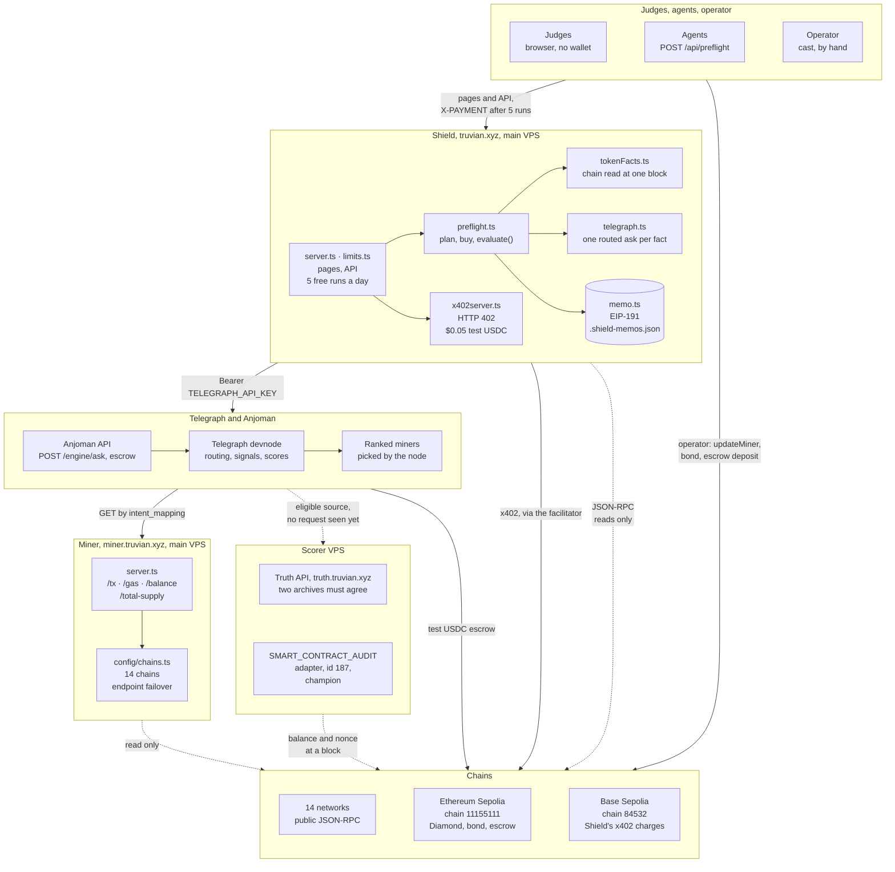
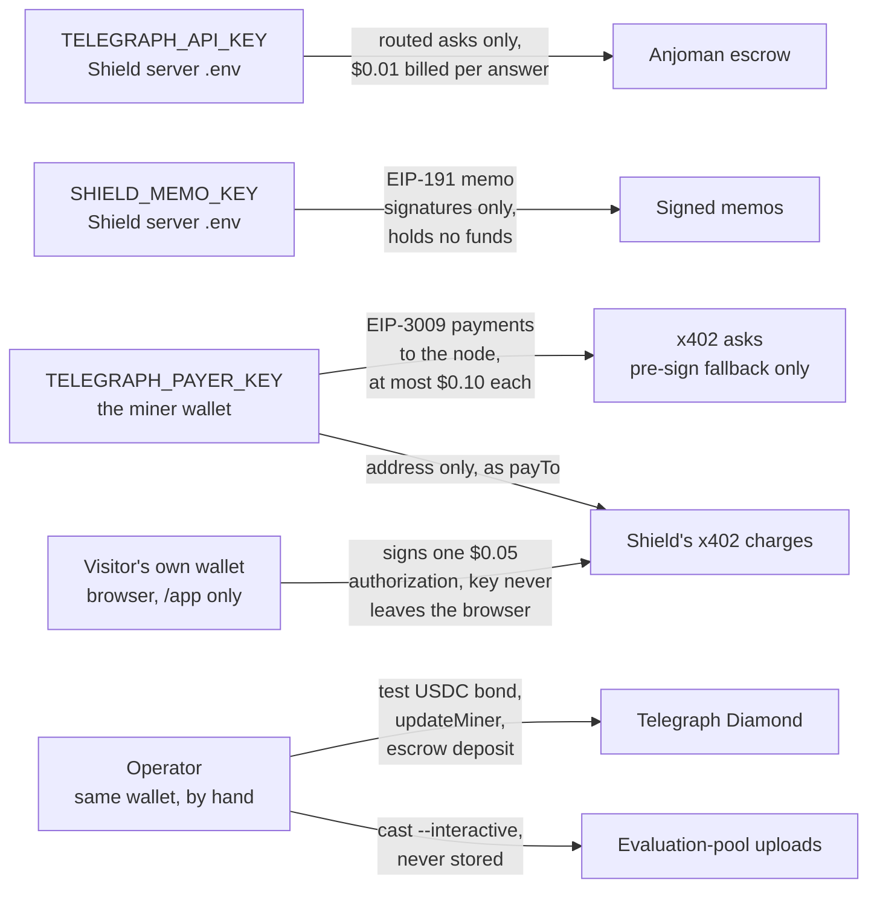
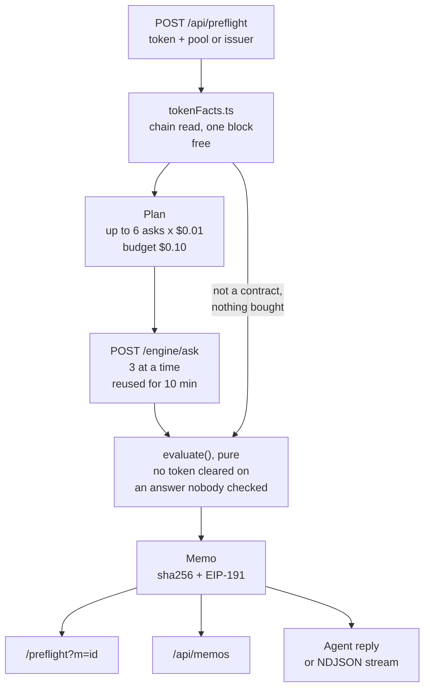
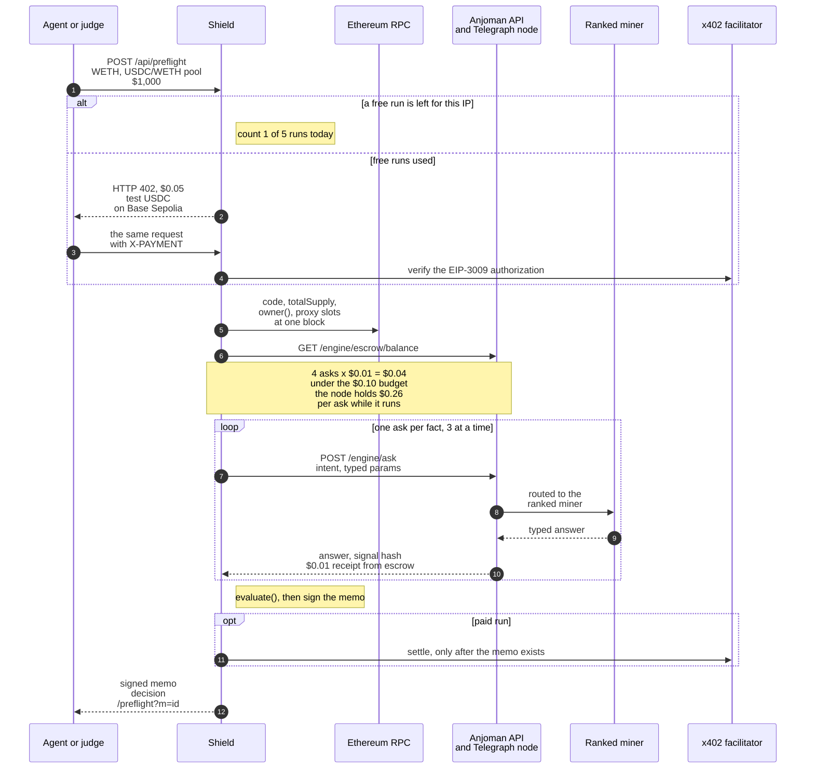
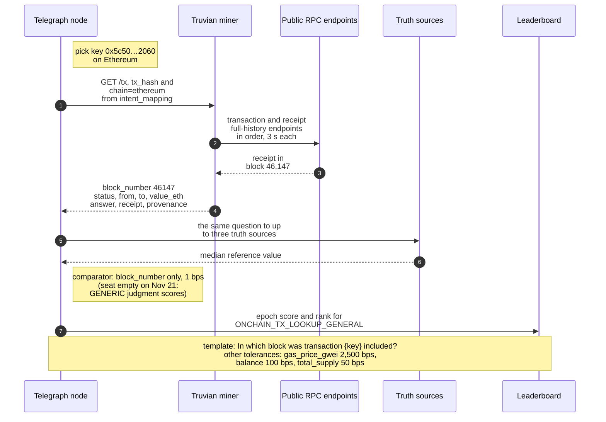
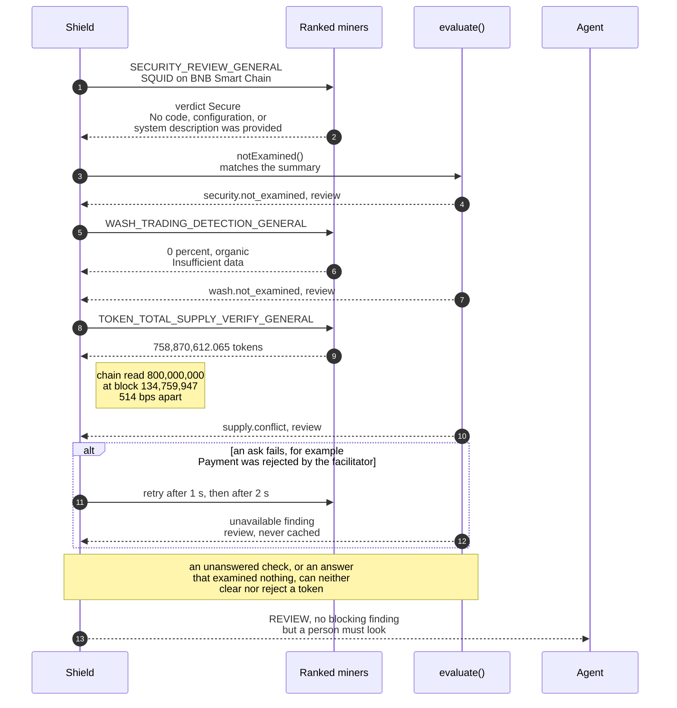
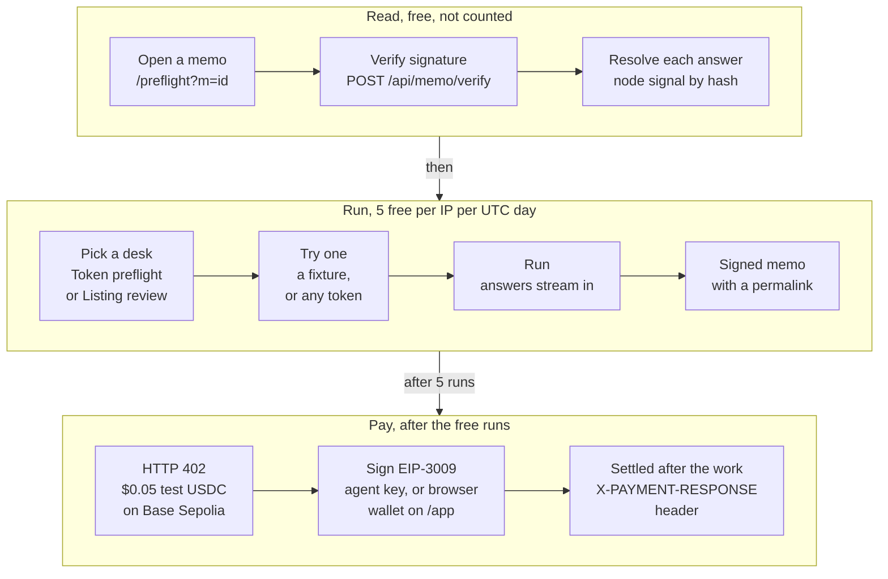

# Truvian

**Truvian decides about a token before anyone acts on it: Telegraph miners supply the evidence, and the chain checks it.**

Truvian enters three tracks of Telegraph Protocol's Season II hackathon from one codebase: **Truvian Shield**, two decision desks for trading agents and exchange listings; a miner that answers four onchain questions; and reference data the node may score other miners against (three sources eligible in its evaluation pool, none yet seen in use). Everything is measured by one rule: **no token is cleared on an answer nobody checked**.

Built for Telegraph Protocol Season II (Nov 1 to Dec 1, 2026) · **Independent entry, not affiliated with Telegraph Protocol or Anjoman** · App: [truvian.xyz/preflight](https://truvian.xyz/preflight) · Miner: [miner.truvian.xyz](https://miner.truvian.xyz) · Truth source: [truth.truvian.xyz](https://truth.truvian.xyz) · Demo: `<VIDEO_URL>` · Code: [github.com/mrnetwork0001/Truvian](https://github.com/mrnetwork0001/Truvian)

**Network:** Telegraph's devnode. Answers are paid in test USD Coin (USDC), which has no value, from an escrow on Ethereum Sepolia; Shield's own charges are test USDC on Base Sepolia; token facts are read from mainnets. Costs, prices and payments below are test USDC; trade sizes and pool depths are mainnet dollar figures.

**Judges, start here:** each track below in the rules' five steps, free and with no wallet or login. The method, the rules table and nine documented failure cases are in [`telegraph/PREFLIGHT.md`](telegraph/PREFLIGHT.md).

| Track | Run it | Check it | Inspect the request and payment | Break it | Reproduce it |
| --- | --- | --- | --- | --- | --- |
| **Apps · Mission 14**, token preflight | [`/preflight`](https://truvian.xyz/preflight) → **Try one:** a fixture → **Run preflight** | **Verify signature** under the memo | [`B4k2AxbY`](https://truvian.xyz/preflight?m=B4k2AxbY): four answers, each with its node signal and escrow receipt; the payer's [ledger](https://devnode.telegraphprotocol.com/v1/ledger/account/0x29476125898638c8634a97fdca8994530e8c9055) | **Try one:** *Not a token (vitalik.eth)*: REJECT, nothing bought ([`HnCGMGFK`](https://truvian.xyz/preflight?m=HnCGMGFK)) | `npm run test:preflight` |
| **Apps · Mission 01**, listing review | `/preflight` → **Listing review** → a fixture → **Run listing review** | **Verify signature** | [`WOYbyG3x`](https://truvian.xyz/preflight?m=WOYbyG3x) and [`Pi1JfTCY`](https://truvian.xyz/preflight?m=Pi1JfTCY): signals only, as both predate per-answer receipts | **Try one:** *Sanctioned issuer (Garantex)*: REJECT | `npm run test:preflight` |
| **Apps · Mission 13**, holdings proof | `/preflight` → **Holdings proof** → a fixture → **Run holdings proof** | **Verify signature** | [`JYjvJrmy`](https://truvian.xyz/preflight?m=JYjvJrmy): six answers with receipts, $0.06; REVIEW because the balance miner the node chose answered for another address | **Try one:** *Overstated claim (300M UNI)*: REJECT with the exact shortfall | `npm run test:preflight` |
| **Miner**, registration 6180 | [`/transfer?tx_hash=0xfb4c…`](https://miner.truvian.xyz/transfer?tx_hash=0xfb4c59910686f76d80708cc4830a2b54cbc4ae722c8898306494b9cee0568382&chain=sepolia), a direct request, not a ranked-routed one | [`/api/miners/6180`](https://devnode.telegraphprotocol.com/api/miners/6180): `active`, six intents | update [`0x070cda57…`](https://sepolia.etherscan.io/tx/0x070cda5788b34ec9b8715eac1831ff012df48aad390af91abaa5211e2dea78d3) (6146 before it: [`0xfb4c5991…`](https://sepolia.etherscan.io/tx/0xfb4c59910686f76d80708cc4830a2b54cbc4ae722c8898306494b9cee0568382)); [epoch 35 scores](https://devnode.telegraphprotocol.com/leaderboard/miners/epoch/35); the wallet's [ledger](https://devnode.telegraphprotocol.com/v1/ledger/account/0xcd0a2370f2dc12c1802707b7d9ab3fec891e3c02), credited 0 | [`/total-supply?token=Bancor (USDC) on Ethereum`](https://miner.truvian.xyz/total-supply?token=Bancor%20%28USDC%29%20on%20Ethereum): refused, the name contradicts the symbol | `npm run test:miner` |
| **Evaluator**, truth sources | [`truth.truvian.xyz/balance?…`](https://truth.truvian.xyz/balance?chain=polygon&address=0xd8dA6BF26964aF9D7eEd9e03E53415D37aA96045&block=81555727) | `agreed_by` names the two archive endpoints that agreed | our pool rows for [`ONCHAIN_METRIC_VERIFY_GENERAL`](https://devnode.telegraphprotocol.com/api/evalpool/submissions/mine?submitter=0xcd0a2370f2dc12c1802707b7d9ab3fec891e3c02&intent_id=ONCHAIN_METRIC_VERIFY_GENERAL) and [`GAS_PRICE_GENERAL`](https://devnode.telegraphprotocol.com/api/evalpool/submissions/mine?submitter=0xcd0a2370f2dc12c1802707b7d9ab3fec891e3c02&intent_id=GAS_PRICE_GENERAL) | [a block beyond the tip](https://truth.truvian.xyz/balance?chain=ethereum&address=0xd8dA6BF26964aF9D7eEd9e03E53415D37aA96045&block=999999999): refused with status 422 | `npm run verify:truth` |

---

## Five verbs, no wallet needed

| Feature | What it is | Try it without a wallet |
| --- | --- | --- |
| **Preflight** · Apps, Mission 14 | The **token preflight** desk ([bounties#202](https://github.com/telegraphprotocol/bounties/issues/202)) answers a trading agent's question, "may I buy $1,000 of this token through this pool?", with HOLD, REVIEW or REJECT. Shield reads the contract itself at one block, then buys four facts at $0.01 each: security review, total supply, wash trading and pool depth. A missing answer, a supply more than 50 basis points (bps, hundredths of a percent) off the chain read, or an answer that examined nothing means REVIEW. The buy is *simulated, nothing sent*. `SECURITY_REVIEW_GENERAL` stands in for `SMART_CONTRACT_AUDIT_GENERAL`, which the node has not opened ([bounties#224](https://github.com/telegraphprotocol/bounties/issues/224)). *A miner can call a rug pull Secure. It can't clear one.* | [`/preflight?m=B4k2AxbY`](https://truvian.xyz/preflight?m=B4k2AxbY) (WETH, wrapped ether: REVIEW, a receipt per answer) and [`/preflight?m=FKLfi2qT`](https://truvian.xyz/preflight?m=FKLfi2qT) (SQUID, the 2021 rug pull, rated *Secure* by a miner that never saw its code; the chain read caught a supply 514 bps short). FKLfi2qT predates the not-examined rule, so its page still lists that *Secure* as a pass; `npm run test:preflight` replays it to REVIEW. To run one: `/preflight` → **Try one:** a fixture → **Run preflight** (5 free runs per Internet Protocol (IP) address a day, reset at 00:00 Coordinated Universal Time (UTC); each costs Truvian about $0.04). |
| **Review** · Apps, Mission 01 | The **listing review** desk ([bounties#189](https://github.com/telegraphprotocol/bounties/issues/189)) gives an exchange's listings desk LIST, REVIEW or REJECT for a token, its issuer and its treasury wallet. It also screens the issuer's legal name against sanctions lists and buys the treasury's balance, which must match Shield's own read within 5 bps. On Nov 20 "Garantex Europe OU" matched a sanctions list with a score of 1: REJECT. That memo also blocks on an 86% wash figure from an answer that saw no trades; it predates commit `4100f8a`, which makes such a figure a review, so the REJECT rests on the sanctions match. | [`/preflight?m=WOYbyG3x`](https://truvian.xyz/preflight?m=WOYbyG3x) (Garantex, REJECT) and [`/preflight?m=Pi1JfTCY`](https://truvian.xyz/preflight?m=Pi1JfTCY) (UNI by "Uniswap Labs", REVIEW: a refused security review, "Insufficient data" on wash trading, and a 0.85 near match for the issuer). Both predate per-answer receipts. To run one: `/preflight` → **Listing review** → a fixture → **Run listing review** (same free allowance). |
| **Prove** · Apps, Mission 13 | The **holdings proof** desk lets an investor agent check what a fund or index says a custody wallet holds, without trusting the issuer. For up to three holdings Shield reads each balance and supply on-chain at one block and buys the same balance, the total supply and, for a rebalancing pool, its liquidity ($0.01 each, with receipts). VERIFIED only when every claim is covered and every bought answer agrees; a holding short of its claim on the chain is REJECT; a missing or disagreeing answer is REVIEW. The memo states each holding's share of supply and the pool's depth. | [`/preflight?m=JYjvJrmy`](https://truvian.xyz/preflight?m=JYjvJrmy) (ENS DAO treasury: REVIEW, the node's balance miner answered for another address) |
| **Answer** · Miner track | The **miner** is registration 6180 on Telegraph's registry contract (a "Diamond") on Ethereum Sepolia, [`0x72a7…a08b`](https://sepolia.etherscan.io/address/0x72a70e949362670Bf8bceAd24eFC5b8f950aa08b). It serves six intents from 14 chains, and the node scores one field of each: `block_number`, `gas_price_gwei`, `balance`, `total_supply` and `liquidity_usd`; `CRYPTO_TRANSFER_VERIFY_GENERAL` has no response format yet and is judged on the answer text. The last two were added on Nov 23 (registration 6146 before): a transfer's settlement, confirmations, fee and burned base fee from the receipt, and a pool's USD liquidity from its on-chain reserves, checked against GeckoTerminal. Since epoch 32 (Nov 21, evening UTC) it scores **1.0 in all three ranked intents**, tied for first: transaction lookup (11 of 15 ranked miners at 1.0 in epoch 35), total supply (7 of 9) and wallet balance (7 of 8); the listed rank orders tied miners alphabetically ([epoch 35](https://devnode.telegraphprotocol.com/leaderboard/miners/epoch/35)). In epoch 30 the same intents scored 0.296, 0 and 0. The change came with fewer miners ranked per intent and in the epoch our total-supply truth source became active; the node publishes no record of which source built a reference, so that link is not confirmed. No miner's gas price has been ranked since epoch 13 (Nov 18). Earned so far: 0 test USDC, per the node's ledger. | Direct diagnostic GETs, free; the node's scored questions arrive separately: [`/tx?…`](https://miner.truvian.xyz/tx?tx_hash=0xfb4c59910686f76d80708cc4830a2b54cbc4ae722c8898306494b9cee0568382&chain=sepolia) (our registration transaction), [`/gas?chain=base`](https://miner.truvian.xyz/gas?chain=base), [`/balance?address=vitalik.eth&chain=ethereum`](https://miner.truvian.xyz/balance?address=vitalik.eth&chain=ethereum), [`/total-supply?token=Bancor (BNT) on Ethereum`](https://miner.truvian.xyz/total-supply?token=Bancor%20%28BNT%29%20on%20Ethereum), a name and symbol with no address, answered since Nov 21 at 09:50 UTC (pull request #23). Before that fix the miner refused the node's own name-and-symbol supply questions, such as "Kelp DAO Restaked ETH (rsETH) on Ethereum" and "Bancor (BNT) on Ethereum", which is why total supply scored 0. |
| **Referee** · Evaluator track | Three **truth sources** (keyless public application programming interfaces, or APIs, described in the miner format) are `eligible` in the node's evaluation pool: Routescan's balance history and Truvian's own **truth API** for `ONCHAIN_METRIC_VERIFY_GENERAL`, and MetaMask's gas API for `GAS_PRICE_GENERAL`. The truth API answers a balance at a block only when two archive endpoints from different providers agree exactly, else with a Hypertext Transfer Protocol (HTTP) error that the node leaves out of its median. Eligible is not used: no request from the node has reached the truth API yet ([`evaluator/README.md`](evaluator/README.md)), and gas price has had no ranking to feed since epoch 13. | [`truth.truvian.xyz/balance?chain=polygon&…&block=81555727`](https://truth.truvian.xyz/balance?chain=polygon&address=0xd8dA6BF26964aF9D7eEd9e03E53415D37aA96045&block=81555727): the answer names the two endpoints that agreed. Our pool rows: [`ONCHAIN_METRIC_VERIFY_GENERAL`](https://devnode.telegraphprotocol.com/api/evalpool/submissions/mine?submitter=0xcd0a2370f2dc12c1802707b7d9ab3fec891e3c02&intent_id=ONCHAIN_METRIC_VERIFY_GENERAL) and [`GAS_PRICE_GENERAL`](https://devnode.telegraphprotocol.com/api/evalpool/submissions/mine?submitter=0xcd0a2370f2dc12c1802707b7d9ab3fec891e3c02&intent_id=GAS_PRICE_GENERAL). The first upload of each, on Nov 14, was rejected as `source_unparseable` and replaced; the pool marks every row `unverified`. |

### More to explore (no wallet needed)

| Feature | What it is | Where |
| --- | --- | --- |
| **Memo check** | Each memo is hashed with SHA-256 (Secure Hash Algorithm, 256-bit) over its canonical JavaScript Object Notation (JSON) and signed under EIP-191 (the Ethereum Improvement Proposal for signed messages) by [`0x956a…3245`](https://etherscan.io/address/0x956aECB0b0DEfC2f2631C26ec0FF7366Ebb53245), a key that held nothing on Ethereum, Base and both Sepolia testnets on Nov 21. **Verify signature** recomputes the digest; any EIP-191 library recovers the signer offline. Change one field and it fails. | `/preflight?m=<id>` → **Verify signature**, or `POST /api/memo/verify` (free) |
| **Signal lookup** | Every bought answer carries a signal hash that the Telegraph node keeps: the miner, the intent, the answer itself, its $0.01 cost and a keccak256 commitment marked verified. | `/api/signal/<hash>`, or the node's `/engine/v1/signal/<hash>` |
| **Memo feed** | The latest decisions with kind, decision, cost and digest, plus the signer: 8 memos on Nov 21 at 10:07 UTC. The store keeps the latest 100, so download a memo you want to keep. | [`/api/memos`](https://truvian.xyz/api/memos) |
| **Answer reuse** | A fact bought in the last 10 minutes is reused at $0 (`SHIELD_REUSE_TTL_MS`, default 600,000 ms). A failed answer is never reused. | run the same input twice on `/preflight` |
| **Pre-sign check** | The Season I checkpoint, now asking Telegraph's V2 intents: FEE, COUNTERPARTY, VALUE and LIQUIDITY become SAFE, CAUTION or BLOCK. It is looser than the desks: it can say SAFE with two of four checks unanswered (report [`4908ef569c`](https://truvian.xyz/app?r=4908ef569c); see [Safety](#safety)). Its presets run a check at once, from the same free allowance. | [`/app`](https://truvian.xyz/app), `/app?r=<id>` |
| **Agent guard** | `guard()` wraps a viem wallet so `sendTransaction` throws `ShieldBlockedError` on BLOCK and `ShieldUnavailableError` when Shield cannot be reached (it fails closed; `timeoutMs` defaults to 30,000). | [`src/agent/guard.ts`](src/agent/guard.ts), `npm run demo:guard` |
| **Pay per run** | Past the free allowance Shield answers with HTTP status 402, Payment Required, and a price under x402, a protocol for paying per request over that status: $0.05 test USDC on Base Sepolia (`SHIELD_PRICE_USD`). `/app` signs it in the visitor's own browser wallet; agents send an `X-PAYMENT` header. Nobody has paid yet: `earnedUsd` was 0 on Nov 21. | `/app` after 5 runs, or any client |
| **Live stats** | Counters across both seasons. On Nov 21 at 10:07 UTC: 15 pre-sign checks (10 of them from September), 8 preflights, 73 Telegraph requests and $0.57 recorded as paid. Nearly all are our own test runs: every preflight, and at least 4 of the 5 checks since September. Costs recorded before Nov 21 at 08:20 UTC understate what the node billed (see below). | [`/api/stats`](https://truvian.xyz/api/stats) |
| **Adapter** | A `SMART_CONTRACT_AUDIT` adapter, a low-rank adaptation (LoRA) layer on Telegraph's ModernBERT-base model, trained on the evaluation pool's three answer formats. Registered on Nov 22 as id 187, it is the intent's **first Canonical adapter and its champion**: the node ranked 83.33% of 30 hidden pairs correctly (floor 70%). Nothing calls the intent yet, because `SMART_CONTRACT_AUDIT_GENERAL` has not opened ([bounties#224](https://github.com/telegraphprotocol/bounties/issues/224)). | [`evaluator/adapter/`](evaluator/adapter), [`/api/wasm/187`](https://devnode.telegraphprotocol.com/api/wasm/187) |

The `/preflight` header carries the Truvian logo, a *Telegraph Season II · Apps & Agents* badge and links to the pre-sign check and the method. Two tabs pick the desk; **Try one:** fills the form with a fixture, and nothing runs until **Run preflight** is pressed. No login or wallet code loads. Answers stream in as they land (newline-delimited JSON, or NDJSON, with `?stream=1`), each with its miner, rank, cost, latency, receipt and node signal. Then come the decision and its cost line, the findings sorted block, review, info, pass, Shield's chain read under the label *Truvian's own JSON-RPC reads, not Telegraph* (JSON-RPC: the remote procedure call interface every Ethereum node serves), and **Verify signature**, **Download memo (JSON)** and **Permalink**.

The landing page (`/`) and `/app` still carry Season I copy: `/app`'s badge reads *Telegraph Season I · Track 3*, and the landing page's pricing, timing and miner names describe the Season I setup. One fixture label is out of date too: *WETH → expect HOLD* came back REVIEW on Nov 21 ([`B4k2AxbY`](https://truvian.xyz/preflight?m=B4k2AxbY)).

**Agents** call `POST /api/preflight`. These two requests are copied from [`telegraph/PREFLIGHT.md`](telegraph/PREFLIGHT.md); each uses one of your 5 free runs:

```bash
# trading agent: may I buy $1,000 of WETH through the Uniswap V3 USDC/WETH pool?
curl -s https://truvian.xyz/api/preflight -H 'content-type: application/json' -d '{
  "mode": "trade", "chain": "ethereum",
  "token": "0xC02aaA39b223FE8D0A0e5C4F27eAD9083C756Cc2",
  "pool":  "0x88e6A0c2dDD26FEEb64F039a2c41296FcB3f5640",
  "tradeUsd": 1000
}' | jq '{decision: .memo.decision, rule: .memo.decisionRule, cost: .memo.cost, url}'

# listings desk: should we list UNI? issuer screened, treasury balance checked
curl -s https://truvian.xyz/api/preflight -H 'content-type: application/json' -d '{
  "mode": "listing", "chain": "ethereum",
  "token": "0x1f9840a85d5aF5bf1D1762F925BDADdC4201F984",
  "issuer": "Uniswap Labs",
  "treasury": "0x1a9C8182C09F50C8318d769245beA52c32BE35BC"
}' | jq '{decision: .memo.decision, findings: [.memo.findings[] | {severity, title}]}'
```

On Nov 21 the first request returned `REVIEW` (*no blocking finding, but at least one finding needs a person*) after four paid answers, $0.04 (memo [`B4k2AxbY`](https://truvian.xyz/preflight?m=B4k2AxbY)). The reply is the signed memo and its permalink; `?stream=1` sends `start`, `chain`, `plan`, one `purchase` per answer, `memo`, `payment` on a paid run, and `done`. After 5 free runs a day per IP, a run costs $0.05: one EIP-3009 signature, a USDC transfer authorization that the x402 facilitator submits, so the caller needs no gas, settled only after the work succeeded.

**The payer.** Shield pays Telegraph from an Anjoman escrow account, [`0x2947…9055`](https://devnode.telegraphprotocol.com/v1/ledger/account/0x29476125898638c8634a97fdca8994530e8c9055), whose ledger the node publishes: on Nov 21 at 10:07 UTC, 22.00 test USDC deposited, 1.09 charged, 0.52 unbilled, 20.91 left. Our own miner wallet minted 20.00 of that and deposited it ([`0x8134…f50e`](https://sepolia.etherscan.io/tx/0x813463a4f64ce8cb03d6638eb9074b4563e8a803deae3c4c29fb6fcb0183f50e), `depositUSDCFor`); anyone can mint the token. Since 08:20 UTC that day every answer carries a receipt: `B4k2AxbY`'s four are $0.01 each, the $0.04 its memo records. The ledger totals the whole account, so trace a decision by its receipts. Before 08:20 UTC Shield used the agent route (`/agent/chat`), whose agent made extra billed calls, so those memos understate the spend: about $0.07 per preflight, not $0.04 ([`telegraph/PREFLIGHT.md`](telegraph/PREFLIGHT.md)).

## Commercial summary

The five answers the rules ask of an app. Every figure comes from testnet runs.

- **Who is it for?** A trading agent about to buy a token it has not vetted (Mission 14), and an exchange's listings desk weighing a candidate token (Mission 01): the agent before each such buy, the desk for each listing.
- **What does it improve?** Instead of one scanner's verdict, Shield buys four answers from the node's ranked miners, checks what it can against its own chain read (supply within 50 bps, a treasury within 5 bps), refuses to count an answer that examined nothing, and signs the result, so every finding traces to a miner and a payment.
- **What does it do today?** Both desks are live at [truvian.xyz/preflight](https://truvian.xyz/preflight). A trade preflight costs $0.04 ($0 when answers are reused or the address is not a token). The one decision on the receipt route took 37 s ([`B4k2AxbY`](https://truvian.xyz/preflight?m=B4k2AxbY)); Nov 20's older route took 39 to 110 s. On the missions' measures: none of the 4 live memos on risky inputs cleared its token (REJECT: [`WOYbyG3x`](https://truvian.xyz/preflight?m=WOYbyG3x), [`HnCGMGFK`](https://truvian.xyz/preflight?m=HnCGMGFK); REVIEW: [`FKLfi2qT`](https://truvian.xyz/preflight?m=FKLfi2qT), [`OSVFy9p0`](https://truvian.xyz/preflight?m=OSVFy9p0)), and every memo is signed. With today's wash-trading answers ("Insufficient data") live runs end in REVIEW; the one live HOLD, [`63zSY25V`](https://truvian.xyz/preflight?m=63zSY25V), predates that rule. With complete evidence HOLD and LIST are reachable: `npm run test:preflight` checks *legitimate token (USDC) clears: HOLD* and *listing: clean issuer and token is LIST*.
- **Why would someone adopt it?** A run costs the caller $0.05 against about $0.04 of answers, a repeat within 10 minutes reuses them at $0, and the memo is evidence anyone can check without trusting Truvian. Before production: mainnet settlement, an open `SMART_CONTRACT_AUDIT_GENERAL`, and latency ([Mainnet readiness](#mainnet-readiness)).
- **How can someone try it?** At `/preflight` in a browser, or with the `curl` requests above. Maintained by mrnetwork0001; issues go to this repository.

### Status and updates

- **Submitted.** Both desks went onto anjoman.ai on Nov 20 and were in review, per our posts that day ([bounties#202](https://github.com/telegraphprotocol/bounties/issues/202#issuecomment-7050353996), [bounties#189](https://github.com/telegraphprotocol/bounties/issues/189#issuecomment-7050354397)). The truth sources went to the Evaluator track the same day ([bounties#190](https://github.com/telegraphprotocol/bounties/issues/190#issuecomment-7043517917)).
- **Dated public updates.** Nov 14: the truth sources' progress on [bounties#87](https://github.com/telegraphprotocol/bounties/issues/87#issuecomment-6884566299) and [bounties#179](https://github.com/telegraphprotocol/bounties/issues/179#issuecomment-6884566459). Nov 20: two reports to Telegraph, [bounties#223](https://github.com/telegraphprotocol/bounties/issues/223) (the adapter kit refuses adapters trained on its default tokenizer) and [bounties#224](https://github.com/telegraphprotocol/bounties/issues/224) (`SMART_CONTRACT_AUDIT_GENERAL` stuck in `registered`), then the desks' progress posts ([bounties#202](https://github.com/telegraphprotocol/bounties/issues/202#issuecomment-7050330386), [bounties#189](https://github.com/telegraphprotocol/bounties/issues/189#issuecomment-7050330781)). Nov 22: the miner's 1.0 scores, on [bounties#202](https://github.com/telegraphprotocol/bounties/issues/202#issuecomment-7076512870) and [bounties#189](https://github.com/telegraphprotocol/bounties/issues/189#issuecomment-7076513068). Nov 23: the adapter becoming the first Canonical scorer for `SMART_CONTRACT_AUDIT`, on [X](https://x.com/encrypt_wizard/status/2124767717165019298) with [its flier](docs/social/2026-11-23-adapter-champion.png), and on [bounties#202](https://github.com/telegraphprotocol/bounties/issues/202#issuecomment-7094215327) and [bounties#189](https://github.com/telegraphprotocol/bounties/issues/189#issuecomment-7094215784).
- **Adoption.** No independent use is confirmed yet, and nobody has paid.
- **Try it on your own token.** Run the first `curl` with your token and pool, and open an issue here if Shield clears something it should not.

## Why Telegraph is essential

Without Telegraph there is no evidence to weigh, no record of who gave it and no score for the miner or the truth sources.

- **No Telegraph, no evidence.** Shield's own reads cover only what a contract says about itself ([`src/shield/tokenFacts.ts`](src/shield/tokenFacts.ts)). Whether its code is safe, its volume real, its pool deep and its issuer clean are Telegraph intents, bought in `runPreflight()` ([`src/shield/preflight.ts`](src/shield/preflight.ts)). With no Telegraph key every purchase fails closed and every token that is a contract goes to REVIEW (`askTypedIntent()` in [`src/shield/telegraph.ts`](src/shield/telegraph.ts)).
- **No Telegraph, no trail.** Each answer comes back with a signal hash the node keeps and, since Nov 21, an escrow receipt: receipt hash, payer, the paid miner's registration and the settlement epoch. The memo stores both for every answer (`Purchase` in [`src/shield/preflight.ts`](src/shield/preflight.ts)), so a decision traces to the miner and the payment it rests on.
- **No Telegraph, no market.** Shield never picks a miner on the paid route. The node routes each ask to its ranked miner for that intent and reports the rank it served (`served_rank`, read in `askTypedIntent()` in [`src/shield/telegraph.ts`](src/shield/telegraph.ts)), so a bad answer is pinned on the provider that gave it.
- **One network scores everything.** The miner exists to answer the node's questions in the fields its descriptor maps ([`telegraph/truvian-miner.yaml`](telegraph/truvian-miner.yaml), `intent_mapping`). The truth sources are eligible to set the references the node scores miners against ([`evaluator/truth-sources/`](evaluator/truth-sources)).

## Architecture

Truvian runs on two virtual private servers (VPSes) and leans on two outside layers. **Shield** ([`src/shield`](src/shield)) is one Fastify app at truvian.xyz that serves the pages and the API. The **miner** ([`src/miner`](src/miner)) runs beside it under pm2 at miner.truvian.xyz. The **truth API** ([`src/truth`](src/truth)) runs on a second server, which also holds the adapter's training run. **Telegraph** is the devnode, which routes, ranks, keeps signals and scores, plus Anjoman's API, which bills the escrow. Under everything are **the chains**: 14 networks read over public JSON-RPC, including Ethereum Sepolia, where the registration, the bond and the escrow settle, and Base Sepolia, where Shield's own charges would settle. The diagrams below render on GitHub; the deeper write-ups are [`telegraph/PREFLIGHT.md`](telegraph/PREFLIGHT.md), [`telegraph/REGISTRATION.md`](telegraph/REGISTRATION.md) and [`evaluator/README.md`](evaluator/README.md).

### System overview



**One repository, three apps.** `src/shield`, `src/miner` and `src/truth` are Fastify servers that tsx runs straight from TypeScript, with no build step; the arrows join groups, and their labels name what crosses. **State.** Shield keeps the latest 100 memos, the latest 50 pre-sign reports and its counters in gitignored `.shield-*.json` files; the miner and the truth API write nothing to disk (the miner holds CoinGecko's token lists in memory for 6 hours, and the truth API caches answers for blocks at least 128 below the tip). **Keys.** Only Shield's process and the operator hold keys, as the next diagram shows.

### Who holds which key



| Key | Lives in | Can | Can never |
| --- | --- | --- | --- |
| `TELEGRAPH_API_KEY` (Anjoman bearer key) | `/opt/truvian/.env` on the Shield server | Ask routed questions paid from the Anjoman escrow (`POST /engine/ask`), cancel a job, read the escrow balance. The node bills $0.01 per answer and holds $0.26 while an ask runs. | Be used by Shield for a preflight whose plan is priced above $0.10, or for any new run once the day's recorded spend is within $0.04 of $5. Shield makes no deposit, withdrawal or transfer call with it. |
| `SHIELD_MEMO_KEY` | `/opt/truvian/.env` on the Shield server | Sign `Truvian Shield memo sha256:<hex>` under EIP-191, once per memo | Sign a transaction (the code only calls `signMessage`), or move funds: its address held nothing on four networks on Nov 21. |
| `TELEGRAPH_PAYER_KEY` (the miner wallet, [`0xCd0a…3c02`](https://sepolia.etherscan.io/address/0xcd0a2370f2dc12c1802707b7d9ab3fec891e3c02)) | `/opt/truvian/.env` on the Shield server, and the operator's own machine | In Shield: give its address as the payTo for x402 charges, and sign EIP-3009 payments to the node of at most $0.10 each (`SHIELD_MAX_PAYMENT_USDC`), used only when a pre-sign check's API-key route fails. By hand, outside this code: mint and approve the bond, `updateMiner`, mint test USDC and deposit it into the escrow (`depositUSDCFor`, 20 test USDC on Nov 21), sign evaluation-pool uploads. | Be used by any code in this repository to send a transaction: no file in `src/` calls `sendTransaction` or `writeContract` with it. |
| No user key | The visitor's own browser wallet, only on `/app` | Sign one $0.05 test USDC authorization (EIP-3009, a signed transfer that someone else submits) when the free runs are used | Reach Shield: no private key is ever sent, and `/preflight` loads no wallet code. |

The miner and the truth API hold no key at all. None of Truvian's servers broadcasts a transaction: trades are simulated, the guard only hands an approved transaction to the agent's own wallet, and the registration is sent by hand ([`telegraph/REGISTRATION.md`](telegraph/REGISTRATION.md)).

### Preflight and Review: token to signed memo



`evaluate()` is pure: the same chain read and answers always give the same findings and decision, and the thresholds (`POLICY`) are written into every memo so anyone can re-derive it. A trade plans up to four asks and a listing up to six; the treasury check is bought only on Ethereum, Polygon and Arbitrum, the chains `ONCHAIN_METRIC_VERIFY_GENERAL` accepts. Every chain fact in a memo carries the label *Truvian chain registry, not Telegraph*, so a reader can tell Shield's own reads from bought answers.

### Preflight: one paid decision, end to end



This is the route since Nov 21 at 08:20 UTC (pull request #22): one billed miner call per fact, each with a receipt. Admission comes before any money moves: invalid input gets HTTP 400 and uses no allowance, and a paying caller is charged only after the memo exists. An address with no contract code stops after the chain read: REJECT at $0, nothing bought.

### Answer: the node asks, the miner answers



The intent's format names a comparator on `block_number`, but no comparator holds the seat: on Nov 21 at 10:13 UTC the node resolved `ONCHAIN_TX_LOOKUP_GENERAL`, `WALLET_BALANCE_CHECK_GENERAL` and `TOKEN_TOTAL_SUPPLY_VERIFY_GENERAL` to its GENERIC judgment model (`GET /api/wasm?resolve=<INTENT>`: `served_by` GENERIC, `generic_fallback` true), which reads the stored reply as JSON with its keys sorted and only its first 512 tokens; gas price is scored by its comparator. So the default `/tx` reply is concise: the intent's fields, one answer, the receipt's outcome, gas and total fee (L1 fee included), and a provenance block naming the public endpoints and methods it was read from, the block hash, the read time and the terms those endpoints are used on (no licence held or claimed, terms of use not reviewed). `&detail=full` adds the calldata, decoded ERC-20 transfers and every fee part; an unknown hash answers `status: not_found` with the endpoints that proved it absent. The template, the question key and the comparator settings are the node's own (`GET /engine/v1/intents/<INTENT>` → `evaluation.comparator`, read Nov 21). A pruned endpoint answers null instead of an error, so the miner treats null as no evidence and keeps searching, and "not found" needs a full-history endpoint to say so, confirmed by a second ([`src/miner/txLookup.ts`](src/miner/txLookup.ts)). For supply, a symbol in parentheses after a name, as in `Bancor (BNT)`, finds the contract in a verified table or CoinGecko's token list for that chain; the name must agree, and the contract's `symbol()` must match at the block before any figure is given ([`src/miner/tokenList.ts`](src/miner/tokenList.ts), [`src/miner/holdings.ts`](src/miner/holdings.ts)).

### Preflight: what cannot clear a token



These are the answers memo `FKLfi2qT` bought on Nov 20 between 20:33:53 and 20:34:31 UTC, replayed through today's rules. The memo was decided minutes before the not-examined rules landed (commits `5f7337c` at 20:36 UTC and `4100f8a` at 20:41 UTC), so its page shows both empty answers as passes and rests its REVIEW on the supply conflict alone.

**Break it yourself.** Each case takes one click or one request. All nine documented cases are in [`telegraph/PREFLIGHT.md`](telegraph/PREFLIGHT.md#failure-cases-a-reviewer-can-reproduce); six you can trigger yourself, and the rest depend on the network failing.

| Case | How | Result |
| --- | --- | --- |
| Not a contract | **Try one:** *Not a token (vitalik.eth)*, or memo [`HnCGMGFK`](https://truvian.xyz/preflight?m=HnCGMGFK) | REJECT, nothing bought, $0 |
| Every answer failed | memos [`9AicKdEB`](https://truvian.xyz/preflight?m=9AicKdEB) (WETH) and [`OSVFy9p0`](https://truvian.xyz/preflight?m=OSVFy9p0) (SQUID), Nov 20 | REVIEW, $0: "Payment was rejected by the facilitator" on all four asks |
| Supply conflict | memo [`FKLfi2qT`](https://truvian.xyz/preflight?m=FKLfi2qT) (SQUID) | REVIEW: the supply answer is 514 bps from the chain read |
| Sanctioned issuer | **Listing review** → **Try one:** *Sanctioned issuer (Garantex)*, or memo [`WOYbyG3x`](https://truvian.xyz/preflight?m=WOYbyG3x) | REJECT on the sanctions match |
| Price impact | **Try one:** *Whale-size trade* | REVIEW: the trade is too large a share of the pool |
| Tampered memo | **Download memo (JSON)**, change any field, then send it to `POST /api/memo/verify` | `signedByThisShield: false` |

### Onboarding: read, run, pay



There is no login, so the only part of Shield's state that tracks a visitor is the per-IP counter, which lives in memory and resets at 00:00 UTC ([`src/shield/limits.ts`](src/shield/limits.ts)). On `/preflight` a used-up allowance shows the 402 message as an error: paying for a preflight is an API step, and the browser-wallet flow exists only on `/app`, for the pre-sign check.

### One decision, end to end: memo `B4k2AxbY`

On Nov 21, starting at 08:19:41 UTC, Shield decided whether a trading agent could buy $1,000 of WETH through the Uniswap V3 USDC/WETH pool [`0x88e6…5640`](https://etherscan.io/address/0x88e6A0c2dDD26FEEb64F039a2c41296FcB3f5640). It read the WETH contract [`0xC02a…6Cc2`](https://etherscan.io/address/0xC02aaA39b223FE8D0A0e5C4F27eAD9083C756Cc2) at Ethereum block 26,462,238 (total supply 2,150,131.754), found $0.73 in the escrow, then bought four answers at $0.01 each through `POST /engine/ask`. Each signal resolves on the node with its keccak256 commitment verified, and each receipt is paid by the escrow account [`0x2947…9055`](https://devnode.telegraphprotocol.com/v1/ledger/account/0x29476125898638c8634a97fdca8994530e8c9055) and settles in epoch 30:

| Fact | Miner (served rank) | Answer | Signal | Escrow receipt |
| --- | --- | --- | --- | --- |
| Security review | NVD Keyword Review (1) | `Secure`, 0 vulnerabilities, yet three issues listed: Common Weakness Enumeration (CWE) entries 668 and 252, and a "phantom function" integration hazard | [`0x46e2f154…`](https://devnode.telegraphprotocol.com/engine/v1/signal/0x46e2f154f2856fd7bc3436d169feff5a73b79706dff24a0d42b436ab910732aa) | `0xf8e43ef6…` |
| Total supply | LiveCert (1) | 2,150,135.626, 0.0 bps from the chain read | [`0x57bb4f2b…`](https://devnode.telegraphprotocol.com/engine/v1/signal/0x57bb4f2b73514959a9baa0e61dbf9f7399054e2f78891005910986621334e190) | `0x84cf18d0…` |
| Wash trading | TxLens (3) | 0%, "inconclusive", after "Insufficient data" | [`0x12a3d4a9…`](https://devnode.telegraphprotocol.com/engine/v1/signal/0x12a3d4a9461b0d4e687dcdfe30a1e51ef2756591a28a59eb6d2e4b5e322217be) | `0x1ad16bfe…` |
| Pool depth | VerifyWire Liquidity Depth (1) | $67,634,825 | [`0xa6602489…`](https://devnode.telegraphprotocol.com/engine/v1/signal/0xa660248967ec8cf8ff536ca6895e07c3f848699eda201cda7beba4439cfdf5ef) | `0xa16fd7b3…` |

The memo says **REVIEW** after 37.4 s for $0.04, and its simulated buy was not placed. Each listed security issue is a review finding, and the wash answer examined nothing, so no token is cleared on it. Its sha256 is `ccb0f775…`, and `POST /api/memo/verify` recovers the signer `0x956a…3245` (checked Nov 21). The same request on Nov 20, memo [`63zSY25V`](https://truvian.xyz/preflight?m=63zSY25V), said HOLD under the rules before commit `5f7337c`; replayed through today's `evaluate()` it is REVIEW.

## Safety

**`evaluate()`** ([`src/shield/preflight.ts`](src/shield/preflight.ts)) is the only path from Telegraph answers to a decision. It clears a token only when every planned check answered and none raised a review or blocking finding (findings that only inform, such as an upgradeable proxy, are disclosed): a miner's verdict alone never clears anything.

- **Shield never sends a transaction.** The trade is simulated, and every memo says `simulated: true, executed: false`. The only signing in Shield is EIP-191 memo messages (`memo.ts`) and EIP-3009 payment data (`telegraph.ts`, `x402pay.ts`). Nothing in `src/` calls `writeContract`, and the only `sendTransaction` calls are the guard, which hands an approved transaction to the agent's own wallet, and stand-in wallets in tests and demos.
- **Spending limits, checked before anything is bought:** a preflight plan above $0.10 (`SHIELD_PREFLIGHT_BUDGET_USD`) is *Over budget*, and an escrow below $0.26 is *Escrow too low to buy*; both mean REVIEW with nothing bought. At most 3 asks run at once, fewer when the escrow is low. Pre-sign checks have no plan budget: they ask four intents, within the daily brakes. Shield refuses to sign an x402 payment above $0.10 (`SHIELD_MAX_PAYMENT_USDC`).
- **Free-tier brakes** ([`src/shield/limits.ts`](src/shield/limits.ts)): 3 runs per minute and 5 per UTC day per IP, 300 a day across everyone, and no new run once the day's recorded spend is within $0.04 of $5. They are checked cheapest first and reset at 00:00 UTC, and the daily totals survive a restart.
- **Input protection:** the body is validated before any allowance is used (HTTP 400 `INVALID_INPUT`). Addresses are checksummed, a trade must be above $0 and at most $1,000,000,000, and an issuer name is at most 120 characters. An address with no contract code is REJECTed at $0; an EIP-7702 delegation (an account pointing at contract code) does not count as code. A chain that does not answer gives HTTP 503 `CHAIN_UNAVAILABLE`: nothing bought, no decision.
- **Evidence protection:** the supply must agree with the chain read within 50 bps and a treasury balance within 5 bps. An answer that says it examined nothing counts as no evidence (`notExamined()`), and a failed answer is never reused. A Telegraph reply that starts `unavailable:` is never parsed as an answer, since a "$0.01" inside a payment error was once read as an ETH price ([`src/shield/server.ts`](src/shield/server.ts)).
- **Fails closed.** A check that does not answer is REVIEW, never a pass. The agent guard refuses to sign when Shield cannot be reached, unless `allowOnShieldFailure` is set ([`src/agent/guard.ts`](src/agent/guard.ts)).
- **Kill switches:** `SHIELD_PAYMENTS=off` stops charging. Removing `TELEGRAPH_API_KEY` stops every preflight purchase, and every contract then goes to REVIEW. `SHIELD_DAILY_SPEND_USD` caps a day's spend, and `pm2 stop truvian-shield` stops Shield without touching the miner.
- **Only the operator touches the chain.** The bond and `updateMiner` are sent by hand with `cast`, after a free dry run (`cast call`) and after checking the Diamond address on the [addresses page](https://anjoman.ai/docs/protocol/addresses-and-params), because a transaction to a retired Diamond succeeds and is never scored ([`telegraph/REGISTRATION.md`](telegraph/REGISTRATION.md)).
- **One known gap, in the older check.** The pre-sign check ([`src/shield/verdict.ts`](src/shield/verdict.ts)) subtracts only 10 points for an unanswered check, so two unanswered checks out of four still score 80, SAFE (report `4908ef569c`). The preflight desks do not have this gap.
- **Tests on main, Nov 21:** 106 Shield checks, 39 preflight checks, 25 truth API checks, 51 truth-source checks against the chain and 200 live miner checks over 14 chains. See their status under [Run it locally](#run-it-locally).

## Mainnet readiness

- **Already on mainnet data.** Shield reads token facts from the 12 mainnets in its registry (2 testnets as well), and the miner answers from the same 14 chains.
- **One setting moves Shield's charges.** `X402_CHAIN_ID=8453` with `X402_USDC_ADDRESS` set to Base's USDC charges on Base mainnet; `/api/stats` still labels the network `base-sepolia` (hard-coded in [`src/shield/server.ts`](src/shield/server.ts)), so that label needs a code change.
- **Waits on Telegraph.** Answers are paid from an Anjoman escrow on Ethereum Sepolia; paying in real USDC needs Telegraph's mainnet escrow. `SMART_CONTRACT_AUDIT_GENERAL`, the first family both missions name, must open before it can be bought ([bounties#224](https://github.com/telegraphprotocol/bounties/issues/224)).
- **Work left before production.** Give Shield a payer and payTo key of its own: today `TELEGRAPH_PAYER_KEY` is the miner's registration wallet, which also funded the escrow. Move memos from a 100-entry JSON file to a database. Commit the truth API's systemd unit and nginx site to `deploy/`. Add a LICENSE file.
- **Latency.** 37 s for the one decision on the receipt route; 39 to 110 s on Nov 20's older route. Each answer takes as long as the ranked miner that serves it.

## What's real and what's simulated

| Real and live | Simulated, testnet money or self-measured |
| --- | --- |
| Telegraph answers bought through the routed ask, each with a signal hash on the node and, since Nov 21 at 08:20 UTC, an escrow receipt | The trade a preflight allows: *simulated buy of $1000 of WETH through pool …: allowed*, with `executed: false`. Nothing is sent. |
| Chain reads at one block over public JSON-RPC on mainnets (Ethereum, BNB Smart Chain and others), labelled *Truvian chain registry, not Telegraph* | Settlement: answers are paid in **test USDC** from an Anjoman escrow on Ethereum Sepolia, a testnet, and every memo says so in `network.settlement` |
| Signed memos: EIP-191 by `0x956aECB0b0DEfC2f2631C26ec0FF7366Ebb53245`, verifiable offline | Shield's x402 charges are test USDC on Base Sepolia (`0x036CbD53842c5426634e7929541eC2318f3dCF7e`); none collected yet |
| Miner registration 6180 on the Diamond [`0x72a70e949362670Bf8bceAd24eFC5b8f950aa08b`](https://sepolia.etherscan.io/address/0x72a70e949362670Bf8bceAd24eFC5b8f950aa08b) (Ethereum Sepolia, chain 11155111), bonded with 1.50 test USDC ([`0xcc194e1a843B658526D0D5C431f670028582Ae17`](https://sepolia.etherscan.io/token/0xcc194e1a843B658526D0D5C431f670028582Ae17)) | The bond and escrow token is test USDC that anyone can mint, and 20.00 of the escrow's 22.00 deposited was minted by our own miner wallet; neither has market value |
| The miner's answers: live reads on 12 mainnets and 2 testnets | The adapter's 83.33% is on 30 hidden pairs from a pool of 4 contributors, and the intent is not callable yet, so no live answer has been scored by it |
| Three truth sources `eligible` in the node's evaluation pool, checked against archive nodes by `npm run verify:truth` | Unit tests replay answers recorded live on Nov 20 (`test:preflight`) and Sep 5 (`test:shield`), each labelled with its capture date |
| 8 preflights and 15 pre-sign checks on the live service ([`/api/stats`](https://truvian.xyz/api/stats)) | All on testnet settlement and nearly all our own test runs; nobody has paid Shield (`earnedUsd` 0) |
| | The `direct` transport, for local development, asks real miners' public endpoints without paying; every result says `transport: direct` |

## Tech stack

Node.js 22.23.1 on the main VPS (Shield, the miner) and 26.13.1 on the scorer VPS (the truth API), 26 in development; TypeScript 7.0.2 for typechecking, with tsx 4.23.5 running the sources directly (no build step); Fastify 5.11.2 (three HTTP apps), viem 2.55.10 (JSON-RPC reads, EIP-191 and EIP-3009 signing), dotenv 17.4.2, puppeteer-core 25.10 (demo capture); the Telegraph devnode (routing, ranking, signals, scoring, evaluation pool), Anjoman's API at backend.telegraphprotocol.com (`/engine/ask` and escrow), the payai x402 facilitator (Shield's charges); public JSON-RPC endpoints from drpc.org, publicnode.com, mevblocker.io, base.org and others ([`src/config/chains.ts`](src/config/chains.ts)), CoinGecko's public token lists (the miner's name lookup), Routescan and MetaMask's gas API (truth sources); Telegraph's `telegraph-wasm-baseline` kit at commit `1ed063e` with ModernBERT-base and PyTorch 2.15 on six processor cores (the adapter), Rust compiled to WebAssembly (the Season I scorer), Remotion 4.0.290 with React 19 (demo video); pm2 on the main VPS and systemd on the scorer VPS, each behind nginx with certbot certificates.

## Run it locally

You need Node.js 22.12 or later (the floor comes from puppeteer-core, a development dependency; production runs 22.23.1) and npm. Optional: `jq` and Foundry's `cast` (the registration runbook and evaluation-pool uploads), Python 3 (the adapter data), Go (Telegraph's go-tester for the Season I scorer, and the adapter kit's `adapterbuild`), and Rust with the `wasm32-unknown-unknown` target (the Season I scorer).

```bash
git clone https://github.com/mrnetwork0001/Truvian && cd Truvian
npm install
cp .env.example .env     # every value is optional; the table below says what each one enables
npm run shield           # Shield: http://127.0.0.1:8788/preflight and /app
npm run dev              # the miner: http://localhost:8787 (reads PORT and HOST from the shell, not .env)
npm run truth            # the truth API: http://127.0.0.1:8790
```

With no keys at all, the miner, the truth API and every free test work, and Shield serves its pages and stored memos. A preflight still runs its chain read and rejects a non-contract at $0, but every Telegraph purchase fails with *TELEGRAPH_API_KEY is not set*, so every decision is REVIEW: the fail-closed rule, working. `.env.example` ships `SHIELD_TRANSPORT=apikey`; without a key, set `SHIELD_TRANSPORT=direct` and the pre-sign check asks live miners' public endpoints for free. State goes to `.shield-stats.json`, `.shield-receipts.json` and `.shield-memos.json` in the working directory.

| Variable | What it does |
| --- | --- |
| `TELEGRAPH_API_KEY` | The Anjoman API key that pays routed asks from the account's escrow. Create one under [API keys](https://anjoman.ai/dashboard/api-keys) on the anjoman.ai dashboard; its [faucet](https://anjoman.ai/dashboard/faucet) gives test USDC on Sepolia, one claim per account every 24 hours. Required for preflights: unset, every purchase fails and every decision is REVIEW, with nothing bought. |
| `SHIELD_TRANSPORT` (`apikey`, `x402` or `direct`) | How the pre-sign check asks Telegraph. Unset: `apikey` when the key is set, else `x402` when `TELEGRAPH_PAYER_KEY` is set, else `direct` (free, real miners, labelled). x402 payments to the node have failed at settlement since Nov 17 ([bounties#214](https://github.com/telegraphprotocol/bounties/issues/214)). |
| `SHIELD_API_ROUTE`, `SHIELD_X402_ROUTE` | `SHIELD_API_ROUTE=agent` forces the older `/agent/chat` route; unset, Shield uses `/engine/ask`, one billed call per answer with a receipt. `SHIELD_X402_ROUTE=dispatcher` sends x402 asks to the node's dispatcher instead of `/engine/v1/ask`. |
| `TELEGRAPH_API_URL` (default `https://backend.telegraphprotocol.com`), `TELEGRAPH_NODE_URL` (default `https://devnode.telegraphprotocol.com`) | The Anjoman API and the Telegraph node. |
| `SHIELD_MEMO_KEY` | Signs memos under EIP-191. Use a key that holds nothing. Unset, memos are hashed but unsigned (`signature: null`). |
| `SHIELD_PREFLIGHT_BUDGET_USD` (default 0.10), `SHIELD_REUSE_TTL_MS` (default 600000) | The most one preflight may spend (above it: *Over budget*, REVIEW, nothing bought), and how long an answer is reused at $0. |
| `SHIELD_FREE_CHECKS_PER_IP` (5), `SHIELD_BURST_PER_MIN` (3), `SHIELD_DAILY_CHECK_CAP` (300), `SHIELD_DAILY_SPEND_USD` (5) | The free-tier brakes shared by checks, preflights and `/api/verify`, reset at 00:00 UTC. |
| `TELEGRAPH_PAYER_KEY` | The wallet for x402: Shield pays the node with EIP-3009 authorizations of at most `SHIELD_MAX_PAYMENT_USDC` (default 0.10), and its address is the default payTo. Unset: no x402 route, and no charging unless `SHIELD_PAYTO` is set. |
| `SHIELD_PRICE_USD` (0.05), `SHIELD_PAYTO`, `SHIELD_PAYMENTS` | Charging past the free tier with HTTP 402. `SHIELD_PAYMENTS=off` turns charging off, and a used-up allowance then answers 429. |
| `X402_CHAIN_ID` (84532), `X402_USDC_ADDRESS` (Base Sepolia USDC), `X402_FACILITATOR_URL` (payai), `X402_CHAIN` | The x402 network, token and facilitator. Charging on Base mainnet needs both `X402_CHAIN_ID=8453` and `X402_USDC_ADDRESS` set to Base's USDC. `X402_CHAIN` names the chain where the payer's balance is read when `X402_CHAIN_ID` is not 1, 8453 or 84532. |
| `SHIELD_PORT` (8788), `SHIELD_HOST` (127.0.0.1), `SHIELD_TRUST_PROXY`, `SHIELD_PUBLIC_URL` | Shield's bind address; trusting `X-Forwarded-For` unless set to `0`; the public origin used in the x402 `resource` field. |
| `SHIELD_STATS_FILE`, `SHIELD_RECEIPTS_FILE`, `SHIELD_MEMOS_FILE` | Where counters, reports and memos persist (defaults `.shield-*.json`, gitignored). |
| `SHIELD_API_KEY_CONCURRENCY` (3), `SHIELD_API_KEY_MAX_SPEND_USD` (0.3) | Anjoman jobs at once (a fourth waits for a slot; Anjoman would answer it 429), and the most the agent route may reserve per ask. |
| `PORT` (8787), `HOST` (0.0.0.0), `TRUVIAN_MINER_ID` | The miner's bind address and its `/health` id, read from the process environment only. |
| `TRUTH_PORT` (8790), `TRUTH_HOST` (127.0.0.1) | The truth API's bind address. |

The commented template is [`.env.example`](.env.example). It leaves out `SHIELD_API_ROUTE`, `SHIELD_X402_ROUTE`, `SHIELD_API_KEY_*`, `SHIELD_MAX_PAYMENT_USDC`, `SHIELD_STATS_FILE`, `SHIELD_RECEIPTS_FILE`, `TELEGRAPH_API_URL`, `X402_CHAIN` and `TRUTH_*`, which the code reads with the defaults above. Test and demo scripts also read `SHIELD_E2E`, `PREFLIGHT_LIVE`, `READINESS_SKIP_PAID`, `SHIELD_URL` and `PROBE_SETTLE`.

**Tests:**

```bash
npm run typecheck        # tsc --noEmit
npm run test:shield      # verdict engine, limiter, guard; free (SHIELD_E2E=1 adds a live run, paid when a key is set)
npm run test:preflight   # rules over answers recorded live on Nov 20, memo signing; free (PREFLIGHT_LIVE=1 is paid, about $0.08)
npm run test:truth       # truth API rules with stand-in endpoints, live archive reads, HTTP
npm run verify:truth     # each truth-source descriptor built and compared with the chain
npm run test:miner       # live public-RPC checks on all 14 chains; free
```

**Test status on main (`cf7de92`), Nov 21, between 09:56 and 09:58 UTC:**
- **typecheck:** exit 0, no errors.
- **test:shield:** 106 checks pass, 0 fail (`ALL CHECKS PASSED`); the live section was skipped, as it is without `SHIELD_E2E=1`.
- **test:preflight:** 39 checks pass (`all preflight tests passed`).
- **test:truth:** 25 checks pass (`ALL CHECKS PASSED`).
- **verify:truth:** 51 checks pass (`ALL CHECKS PASSED`).
- **test:miner:** `ALL CHECKS PASSED (200 passed, 0 failed, 0 skipped)`. The suite reads public endpoints and CoinGecko's lists live, so an endpoint's bad minute can show up as a failure.

`npm run readiness` boots Shield against live miners and spends test USDC whenever a Telegraph key is set; `READINESS_SKIP_PAID=1` skips only the step that pays Shield over x402. It still asserts that every check was paid over x402, which fails under `SHIELD_TRANSPORT=apikey`. It was not run for this status.

## Deploying

1. **Main server, pm2.** The repository lives at `/opt/truvian`. Run `git pull && npm install`, then `pm2 start deploy/ecosystem.config.cjs` (`truvian-miner` on 127.0.0.1:8787) and `pm2 start deploy/ecosystem.shield.config.cjs` (`truvian-shield` on 127.0.0.1:8788), then `pm2 save`. Secrets go in `/opt/truvian/.env`, which Shield loads with dotenv; the miner needs none. Restart only the app whose files changed.
2. **nginx and TLS.** [`deploy/nginx-shield.conf`](deploy/nginx-shield.conf) (truvian.xyz) and [`deploy/nginx-miner.conf`](deploy/nginx-miner.conf) (miner.truvian.xyz) proxy to those ports, and certbot adds TLS (Transport Layer Security). A preflight took 39 to 110 s on Nov 20, so `/api/` gets 300 s timeouts and no buffering, which streaming needs (commit `028c4b9`).
3. **Truth API, second server.** truth.truvian.xyz runs `src/truth/server.ts` as the systemd service `truvian-truth` on 127.0.0.1:8790, behind nginx limited to 5 requests per second per IP (burst 20, then 429). It runs commit `8043f7d`, and `src/truth` has not changed since. Its unit file and nginx site are not in `deploy/` yet.
4. **The miner registration** is a manual runbook ([`telegraph/REGISTRATION.md`](telegraph/REGISTRATION.md)): check the Diamond address on the [addresses page](https://anjoman.ai/docs/protocol/addresses-and-params), deploy the miner code first, pin the descriptor at a commit and take its SHA-256, mint and approve test USDC for the bond ($1 for the first intent and $0.10 for each further one, from `minerBondParams()`), dry-run `updateMiner` with `cast call`, then send it. Registration 6146 was created by `updateMiner` in transaction [`0xfb4c5991…`](https://sepolia.etherscan.io/tx/0xfb4c59910686f76d80708cc4830a2b54cbc4ae722c8898306494b9cee0568382) (Ethereum Sepolia block 12,177,404, 20:24:36 UTC on Nov 20), from the miner wallet with a 1.30 test USDC bond, and the node recorded it 12.5 minutes later (`registered_at` 20:37:05 UTC). It pins the descriptor at commit `e9eb002` (sha256 `096de4cd…7a83`, the same bytes as [`telegraph/truvian-miner.yaml`](telegraph/truvian-miner.yaml) today). That file's `/tx` and `/gas` descriptions name 10 chains while the code serves 14; changing it means a new `updateMiner`, a new id and a new 7-day grace period.
5. **Evaluation material.** Run `npm run verify:truth`, then `evaluator/upload-truth-source.sh <INTENT> <yaml> <address>`, which signs with `cast wallet sign --interactive`: the key is typed in hidden and never written down. Uploading is free and registers nothing onchain; a row becomes `eligible` after the next epoch.
6. **Adapter.** Trained on the second server, finishing at 04:00 UTC on Nov 21 (run `run-v1`: 2,040 training pairs, 91.1% on 360 held out). A first package, `SMART_CONTRACT_AUDIT.safetensors` (6,776,916 bytes), was written at 08:08 UTC the same day, and its manifest built at 08:12 UTC; packaging and the test on Telegraph's public pairs are still in progress. Registering it needs a $5 test USDC bond and a public address the node can fetch it from. The intent `SMART_CONTRACT_AUDIT_GENERAL` is still in the node's `registered` state with no response format, so it cannot be asked yet ([bounties#224](https://github.com/telegraphprotocol/bounties/issues/224)).
7. **Production** is live at [truvian.xyz/preflight](https://truvian.xyz/preflight), [miner.truvian.xyz](https://miner.truvian.xyz) and [truth.truvian.xyz](https://truth.truvian.xyz). On Nov 21 the main server ran main at `cf7de92` on Node.js 22.23.1: the miner was restarted on it at 09:50 UTC, after pull request #23, and Shield's process has run since 08:19 UTC, started on `a0255f2`; nothing Shield runs changed between the two.
8. **First preflight on the receipt route.** Pull request #22 merged at 08:19:15 UTC on Nov 21. At 08:19:41 UTC memo [`B4k2AxbY`](https://truvian.xyz/preflight?m=B4k2AxbY) started; 37.4 s later it decided WETH as REVIEW for $0.04. Its four answers came from miners ranked 1, 1, 3 and 1, each with an escrow receipt settling in epoch 30 (the security review's receipt is `0xf8e43ef6…`).

## Repository map

```
src/shield/            Shield: server.ts (routes, admit), preflight.ts (desks, evaluate), tokenFacts.ts (chain reads),
                       telegraph.ts (routed asks, transports), memo.ts (canonical JSON, EIP-191), limits.ts,
                       receipts.ts, verdict.ts (pre-sign check), x402server.ts and x402pay.ts (charging), payer.ts,
                       types.ts, X402-NOTES.md (x402 payments to the node, measured Sep 5)
src/shield/public/     /preflight (preflight.html, preflight.js), /app (app.html, app.js, wallet.js),
                       the landing page (index.html), brand/truvian-header.png
src/miner/             the miner: server.ts (routes), txLookup.ts, gasPrice.ts, holdings.ts (balance, total supply),
                       tokenList.ts (CoinGecko's token lists, cached), tokenNames.ts (does a question's name fit the token)
src/config/chains.ts   14-chain registry: endpoints in order, full-history flags, failover
src/config/tokens.ts   verified token contract addresses and names per chain
src/truth/             the truth API: server.ts, balance.ts (two archives must agree)
src/agent/guard.ts     viem wallet wrapper that refuses to sign on BLOCK or when Shield is unreachable
src/types/index.ts     intent payload types and IntentError (answer text on every error)
src/scripts/           test-*.ts, verify-truth-sources.ts, readiness.ts (spends test USDC), demo-guard.ts,
                       pay-check.ts (a reference x402 client), capture, narration and probe tools
evaluator/             truth-sources/ (3 descriptors), upload-truth-source.sh, adapter/ (pair generator, runbook)
telegraph/             PREFLIGHT.md, REGISTRATION.md, TRACK3.md (Season I), truvian-miner.yaml (registration 6180),
                       truvian-miner.registered.yaml (Season I), 13 Season I scorer .wasm builds
deploy/                pm2 apps (truvian-miner, truvian-shield) and nginx sites (truvian.xyz, miner.truvian.xyz)
scorer/                the Season I Rust scorer (rank_answer), fixtures and harnesses
docs/                  SEASON-II.md (network study, Sep 30), shield-build-plan.md, X drafts, social/ fliers
video/                 the Remotion project for the Season I demo video
.env.example           the environment template
```

The top level also holds `TRUVIAN_PROJECT_SPEC.md` (the Season I blueprint, first written Aug 4 and retargeted to Base on Aug 23) and `CLAUDE.md` (notes for the coding agent). The preflight's output format is the `PreflightMemo` type in [`src/shield/preflight.ts`](src/shield/preflight.ts), and [`/api/stats`](https://truvian.xyz/api/stats) shows live usage.

## Data and content policy

- **Other teams' answers are shown as they were given.** Every memo keeps each bought answer with the miner's name and id. The page inserts miner text as plain text, never as markup ([`src/shield/public/preflight.js`](src/shield/public/preflight.js)).
- **What is stored.** Memos keep the request's public fields (chain, token, pool, trade size, issuer, treasury) and the evidence. Pre-sign reports keep the chain, address, value, transaction hash and protocol. Neither stores the caller's IP address, wallet or payment details (`PreflightMemo` in [`src/shield/preflight.ts`](src/shield/preflight.ts), [`src/shield/receipts.ts`](src/shield/receipts.ts)). The per-IP counters stay in memory and reset daily; the servers' request logs (Fastify, nginx) do record client addresses, as web servers do.
- **A sanctions result is a provider's screening, not a legal finding.** It covers the lists the provider names; for Garantex, those of the United States' Office of Foreign Assets Control (OFAC), the United Nations, the European Union and the United Kingdom. A near match, a score of 0.85 or more, goes to a person.
- **A security review is an automated scan, not an audit.** The WETH answer of Nov 20 says so in its own words: "This is an automated scan of the deployed contract, not a manual audit."

## Pre-existing work and credits

- **Season I code (Aug 4 to Sep 7, 2026).** The X Layer probe scripts, the miner's transaction and gas routes, the chain registry, the pre-sign check with its x402 client and server, the agent guard, the Rust scorer and the video project were written for Season I by the same author. Season II reworked them for Telegraph V2 and added the balance and supply routes, ten more chains (4 to 14), the preflight desks, memo signing, the truth API, the truth sources and the adapter data generator (Nov 14 to 21, 2026).
- **Telegraph Protocol and Anjoman** are used as deployed: the devnode, the Diamond on Ethereum Sepolia, the Anjoman API and escrow, and the test USDC token. Truvian deploys no contracts.
- **Telegraph's `telegraph-wasm-baseline` kit** (commit `1ed063e`) and the **ModernBERT-base** model train and package the adapter. Neither is vendored here; the kit's tokenizer problem is reported as [bounties#223](https://github.com/telegraphprotocol/bounties/issues/223).
- **Data and APIs:** public JSON-RPC endpoints ([`src/config/chains.ts`](src/config/chains.ts)), CoinGecko's public token lists, Routescan's balance history and MetaMask's gas API (truth sources), and the payai x402 facilitator. The answers Shield buys come from other teams' miners, named in every memo.
- **Open-source npm packages** are listed in [`package.json`](package.json). The Season I scorer's README has you clone Telegraph's `telegraph-examples` (with its official go-tester) into `scorer/vendor/`, which is gitignored.
- **Everything else** in this repository was written for Telegraph's Season I and Season II hackathons.

## Season I (Aug - Sep 2026)

Truvian placed **3rd in the Season I Miner track, $600**. Telegraph [announced the results on X](https://x.com/Telegraphprotoc/status/2104484144684098021) on Sep 28 in a linked X article, which needs a login to read; this repository recorded the result on Sep 30 (commit `fd60b65`). Season I ran on a Base Sepolia deployment whose contract is now retired:
- the miner `truvian-onchain-truth` (Season I registration 172), re-registered for V2 on the Diamond of Oct 24, imported to the current Diamond as registration 5252 on Nov 17, registration 6146 after the `updateMiner` of Nov 20, and registration 6180 (six intents) since the one of Nov 23;
- a Rust WebAssembly scorer ([`scorer/`](scorer), registrations 544 and 617) that held the `ONCHAIN_TX_LOOKUP` champion seat twice before it was beaten; its 13 builds are in [`telegraph/`](telegraph);
- the Shield pre-sign check at [truvian.xyz/app](https://truvian.xyz/app), with its [Season I demo video](https://x.com/encrypt_wizard/status/2096818596051575158).

The Season I runbook is kept at the bottom of [`telegraph/REGISTRATION.md`](telegraph/REGISTRATION.md) for history.

## License

`package.json` declares the ISC (Internet Systems Consortium) license; the repository has no LICENSE file yet. The Truvian name and logo belong to the author.

---

Truvian is an independent Telegraph Protocol Season II entry and is **not affiliated with Telegraph Protocol or Anjoman**. Settlement runs on testnets, and test USDC has no value. Trades are simulated, and a decision is evidence for a person or an agent to act on, not financial, legal or security advice.
