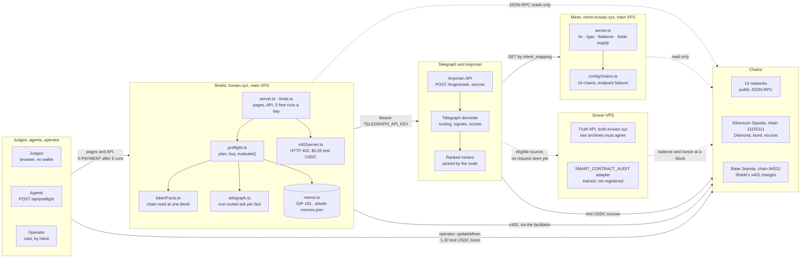
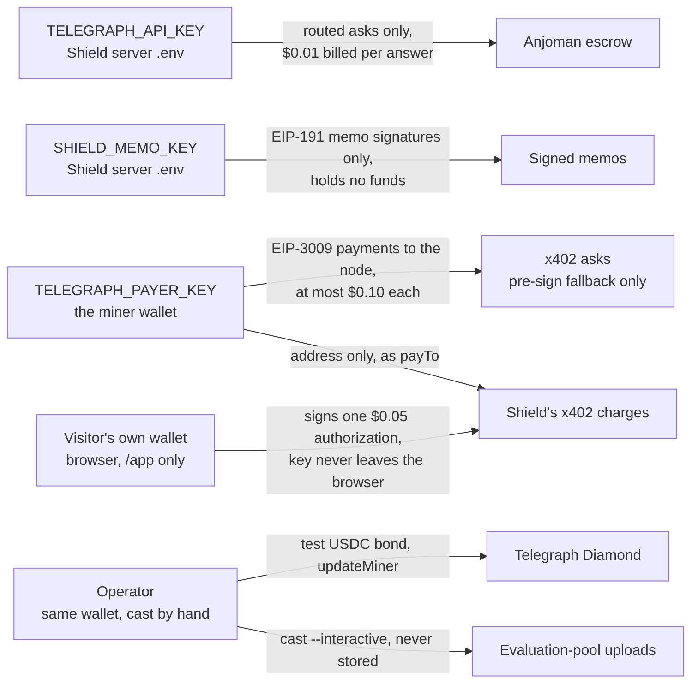
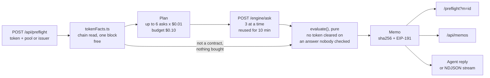
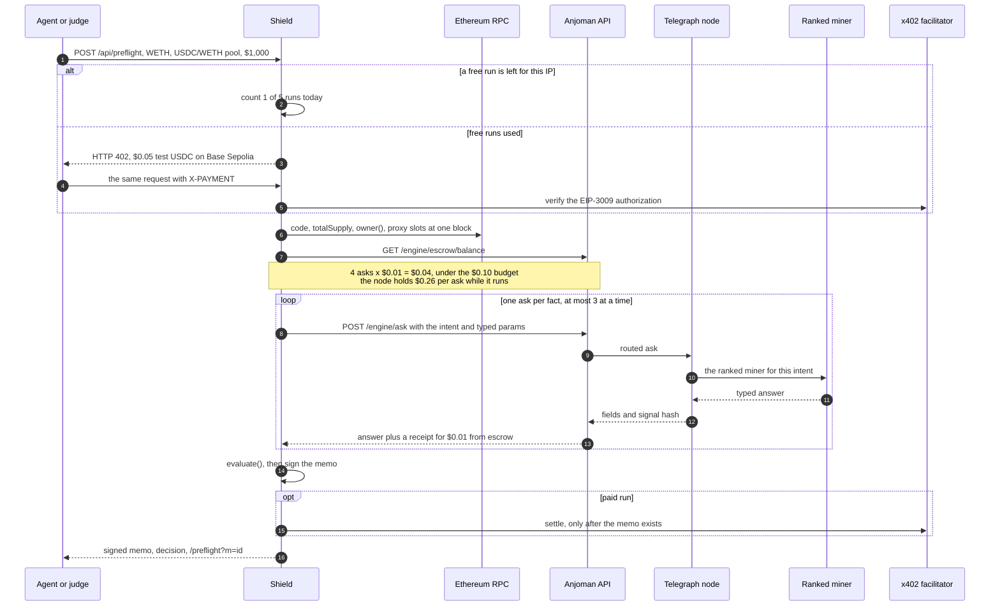
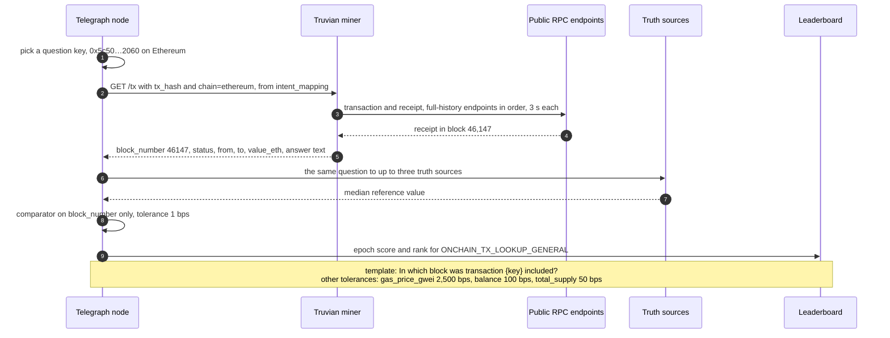
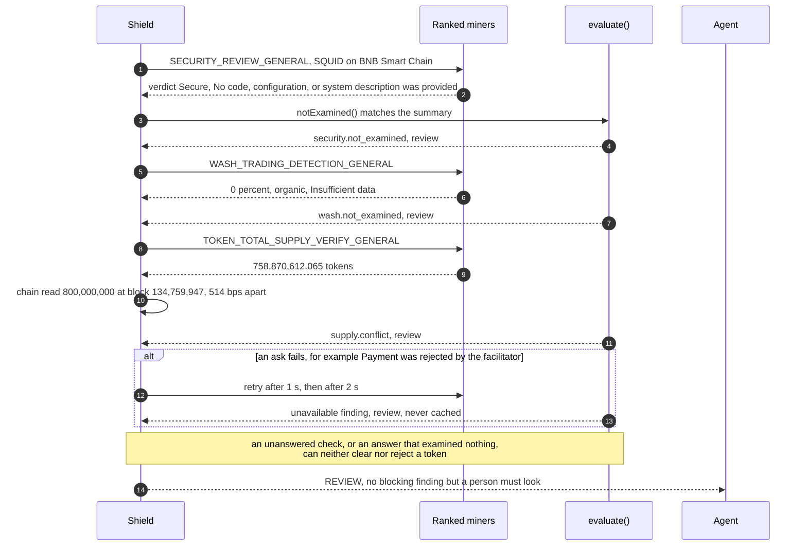
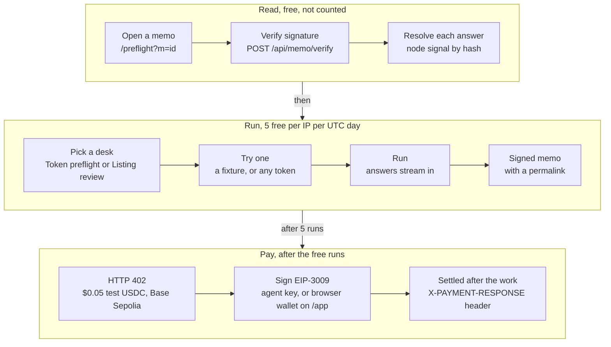

# Truvian

**Truvian decides about a token before anyone acts on it: Telegraph miners supply the evidence, and the chain checks it.**

Truvian enters three tracks of Telegraph Protocol's Season II hackathon from one codebase: **Truvian Shield**, two decision desks for trading agents and exchange listings; a miner that answers four onchain questions; and reference data that other miners are scored against. Everything is measured by one rule: **no token is cleared on an answer nobody checked**.

Built for Telegraph Protocol Season II (Nov 1 to Dec 1, 2026) · **Independent entry, not affiliated with Telegraph Protocol or Anjoman** · App: [truvian.xyz/preflight](https://truvian.xyz/preflight) · Miner: [miner.truvian.xyz](https://miner.truvian.xyz) · Truth source: [truth.truvian.xyz](https://truth.truvian.xyz) · Demo: `<VIDEO_URL>` · Code: [github.com/mrnetwork0001/Truvian](https://github.com/mrnetwork0001/Truvian)

**Judges, start here:** [truvian.xyz/preflight?m=FKLfi2qT](https://truvian.xyz/preflight?m=FKLfi2qT), one signed decision, free to open with no wallet or login: a ranked miner called the SQUID rug pull *Secure*, and Shield's own chain read still kept it from clearing. The method, the full rules table and nine failure cases you can reproduce are in [`telegraph/PREFLIGHT.md`](telegraph/PREFLIGHT.md).

---

## Four verbs, no wallet needed

| Feature | What it is | Try it without a wallet |
| --- | --- | --- |
| **Preflight** | The **token preflight** desk (Mission 14, [bounties#202](https://github.com/telegraphprotocol/bounties/issues/202)) answers a trading agent's question, "may I buy $1,000 of this token through this pool?", with HOLD, REVIEW or REJECT. Shield first reads the contract at one block over its own JSON-RPC connections (remote procedure calls in JavaScript Object Notation, the interface every Ethereum node serves): code, supply, owner and proxy slots. Then it buys four facts through Telegraph at $0.01 each: a security review, the total supply, a wash-trading check and the pool's depth. Fixed rules decide, and **no token is cleared on an answer nobody checked**: an unanswered check, a supply more than 50 basis points (bps, hundredths of a percent) from the chain read, or an answer that says it examined nothing all go to REVIEW. The buy is *simulated, nothing sent*. On Nov 20 a ranked miner rated SQUID, the 2021 rug pull, `Secure` while writing "No code, configuration, or system description was provided to evaluate", and the chain read caught a supply answer 514 bps under the contract's 800,000,000. *A miner can call a rug pull Secure. It can't clear one.* | [`/preflight?m=FKLfi2qT`](https://truvian.xyz/preflight?m=FKLfi2qT) (SQUID, REVIEW) and [`/preflight?m=B4k2AxbY`](https://truvian.xyz/preflight?m=B4k2AxbY) (WETH, wrapped ether, with a payment receipt per answer) are free to read. To run one: `/preflight` → **Try one:** a fixture → **Run preflight** (5 free runs per Internet Protocol (IP) address per day, reset at 00:00 Coordinated Universal Time (UTC); each spends about $0.04 of Truvian's test USD Coin (USDC) escrow). |
| **Review** | The **listing review** desk (Mission 01, [bounties#189](https://github.com/telegraphprotocol/bounties/issues/189)) gives an exchange's listings desk LIST, REVIEW or REJECT for a token, its issuer and its treasury wallet. The same engine also screens the issuer's legal name against sanctions lists and buys the treasury's balance, which must match Shield's own `eth_getBalance` read within 5 bps. On Nov 20 "Garantex Europe OU" matched a listed entity with a score of 1, in a screen of the United States' Office of Foreign Assets Control (OFAC) lists and the United Nations, European Union and United Kingdom lists, and was rejected. UNI by "Uniswap Labs" went to REVIEW: the security reviewer refused to answer, the wash check said "Insufficient data", and the issuer scored 0.85 against a listed name without matching. | [`/preflight?m=WOYbyG3x`](https://truvian.xyz/preflight?m=WOYbyG3x) (Garantex, REJECT) and [`/preflight?m=Pi1JfTCY`](https://truvian.xyz/preflight?m=Pi1JfTCY) (UNI, REVIEW). To run one: `/preflight` → **Listing review** → a fixture → **Run listing review** (same free allowance). |
| **Answer** | The **miner** is registration 6146 on Telegraph's registry contract (a "Diamond") on Ethereum Sepolia, [`0x72a7…a08b`](https://sepolia.etherscan.io/address/0x72a70e949362670Bf8bceAd24eFC5b8f950aa08b). It serves four intents: `ONCHAIN_TX_LOOKUP_GENERAL`, `GAS_PRICE_GENERAL`, `WALLET_BALANCE_CHECK_GENERAL` and `TOKEN_TOTAL_SUPPLY_VERIFY_GENERAL`, read live from 14 chains. The node reads one scored field per intent by name (`block_number`, `gas_price_gwei`, `balance`, `total_supply`). An old transaction is never called missing because one pruned node returned null: "not found" needs a full-history endpoint to say so, confirmed by the next endpoint that answers. Its lookup and supply scores are low, and the cause is not established. In epoch 29 (read Nov 21, 08:31 UTC) transaction lookup scored 0.188 (rank 14 of 29; the leader 0.695), total supply 0 (rank 10 of 26), and wallet balance 0.5, tied with six others for the epoch's top score. Supply questions written `<Name> (<SYMBOL>) on <Chain>` with no address fail on main today; a fix is in progress. | [`/tx?tx_hash=0xfb4c…8382&chain=sepolia`](https://miner.truvian.xyz/tx?tx_hash=0xfb4c59910686f76d80708cc4830a2b54cbc4ae722c8898306494b9cee0568382&chain=sepolia) (our own registration transaction), [`/gas?chain=base`](https://miner.truvian.xyz/gas?chain=base), [`/balance?address=vitalik.eth&chain=ethereum`](https://miner.truvian.xyz/balance?address=vitalik.eth&chain=ethereum), [`/total-supply?token=USDC on Ethereum`](https://miner.truvian.xyz/total-supply?token=USDC%20on%20Ethereum). All free GETs. |
| **Referee** | Truvian also supplies reference answers that miners are scored against. Three **truth sources** (keyless public application programming interfaces, or APIs, described in the miner format) are `eligible` in the node's evaluation pool: Routescan's balance history and Truvian's own **truth API** for `ONCHAIN_METRIC_VERIFY_GENERAL`, and MetaMask's gas API for `GAS_PRICE_GENERAL`. The truth API returns an address's balance at a block only when two archive endpoints from different providers agree exactly; anything less is a Hypertext Transfer Protocol (HTTP) error, which the node leaves out of its median. Eligible is not the same as used: on Nov 21 the truth API's log showed no request from the node yet ([`evaluator/README.md`](evaluator/README.md)). A **`SMART_CONTRACT_AUDIT` adapter**, a low-rank adaptation (LoRA) layer on Telegraph's ModernBERT-base model, was trained on Nov 21; its training run ranks 91.1% of 360 held-out pairs from our own generator correctly. It is not registered: its test on Telegraph's public pairs is still in progress. | [`truth.truvian.xyz/balance?chain=polygon&…&block=81555727`](https://truth.truvian.xyz/balance?chain=polygon&address=0xd8dA6BF26964aF9D7eEd9e03E53415D37aA96045&block=81555727): the answer names the two endpoints that agreed. Our pool rows: [`/api/evalpool/submissions/mine`](https://devnode.telegraphprotocol.com/api/evalpool/submissions/mine?submitter=0xcd0a2370f2dc12c1802707b7d9ab3fec891e3c02&intent_id=ONCHAIN_METRIC_VERIFY_GENERAL) on the node. |

### More to explore (no wallet needed)

| Feature | What it is | Where |
| --- | --- | --- |
| **Memo check** | Each memo is hashed with SHA-256 (Secure Hash Algorithm, 256-bit) over its canonical JSON and signed under EIP-191 (the Ethereum Improvement Proposal for signed messages) by [`0x956a…3245`](https://etherscan.io/address/0x956aECB0b0DEfC2f2631C26ec0FF7366Ebb53245), a key that held 0 on Ethereum, Base and both Sepolia testnets on Nov 21. **Verify signature** recomputes the digest; any EIP-191 library recovers the signer offline. Change one field and it fails. | `/preflight?m=<id>` → **Verify signature**, or `POST /api/memo/verify` (free) |
| **Signal lookup** | Every bought answer carries a signal hash that the Telegraph node keeps: the miner, the intent, the answer itself, its $0.01 cost and a keccak256 commitment marked verified. | `/api/signal/<hash>`, or the node's `/engine/v1/signal/<hash>` |
| **Memo feed** | The latest decisions with kind, decision, cost and digest, plus the signer: 8 memos on Nov 21 at 08:30 UTC. The store keeps the latest 100, so download a memo you want to keep. | [`/api/memos`](https://truvian.xyz/api/memos) |
| **Answer reuse** | A fact bought in the last 10 minutes is reused at $0 (`SHIELD_REUSE_TTL_MS`, default 600,000 ms). A failed answer is never reused. | run the same input twice on `/preflight` |
| **Pre-sign check** | The Season I checkpoint, now asking Telegraph's V2 intents: FEE, COUNTERPARTY, VALUE and LIQUIDITY become SAFE, CAUTION or BLOCK. It is looser than the desks: an unanswered check costs only 10 points, so it can say SAFE with two of four checks unanswered (report [`4908ef569c`](https://truvian.xyz/app?r=4908ef569c)). Its presets run a check at once, from the same free allowance. | [`/app`](https://truvian.xyz/app), `/app?r=<id>` |
| **Agent guard** | `guard()` wraps a viem wallet so `sendTransaction` throws `ShieldBlockedError` on BLOCK and `ShieldUnavailableError` when Shield cannot be reached (it fails closed; `timeoutMs` defaults to 30,000). | [`src/agent/guard.ts`](src/agent/guard.ts), `npm run demo:guard` |
| **Pay per run** | Past the free allowance Shield answers with HTTP status 402, Payment Required, and a price under x402, a protocol for paying per request over that status: $0.05 test USDC on Base Sepolia (`SHIELD_PRICE_USD`). `/app` signs it in the visitor's own browser wallet; agents send an `X-PAYMENT` header. Nobody has paid yet: `earnedUsd` was 0 on Nov 21. | `/app` after 5 runs, or any client |
| **Live stats** | Counters across both seasons. On Nov 21 at 08:30 UTC: 15 pre-sign checks (10 of them from September), 8 preflights, 73 Telegraph requests and $0.57 recorded as paid. Costs recorded before Nov 21 at 08:20 UTC understate what the node billed (see below). | [`/api/stats`](https://truvian.xyz/api/stats) |

The `/preflight` header carries the Truvian logo, a *Telegraph Season II · Apps & Agents* badge and links to the pre-sign check and the method. Two tabs pick the desk. The **Try one:** buttons fill the form with a fixture, and nothing runs until **Run preflight** is pressed. No login and no wallet code load on this page.

Answers stream in as they land (newline-delimited JSON, `?stream=1`): the intent, the answer, the miner, its rank, the cost, the latency, the payment receipt and a link to the signal on the node. Then the decision appears with its cost line (Telegraph cost, paid, reused and failed requests, time, budget, escrow before). Below it come the findings sorted block, review, info, pass; Shield's chain read under the label *Truvian's own JSON-RPC reads, not Telegraph*; and a signature box with **Verify signature**, **Download memo (JSON)** and **Permalink**.

The landing page (`/`) and `/app` date from Season I and still carry its copy: `/app`'s badge reads *Telegraph Season I · Track 3*, and the landing page's pricing, timing and miner names describe the Season I setup. One fixture label is also out of date: *WETH → expect HOLD* came back REVIEW on Nov 21 ([`B4k2AxbY`](https://truvian.xyz/preflight?m=B4k2AxbY)).

**Agents** call `POST /api/preflight` with `{"mode":"trade","chain":"ethereum","token":"0x…","pool":"0x…","tradeUsd":1000}`, or `"mode":"listing"` with an `issuer` and an optional `treasury`. The reply is the signed memo and its permalink; `?stream=1` sends the events `start`, `chain`, `plan`, one `purchase` per answer, `memo`, `payment` on a paid run, and `done`. The path for a caller: read any memo (free) → run 5 a day per IP (free to the caller) → pay $0.05 per run after that (one EIP-3009 signature, a USDC transfer authorization that the x402 facilitator submits, so the caller needs no gas; it is settled only after the work succeeded).

**The payer.** Shield pays Telegraph from an Anjoman escrow account, [`0x2947…9055`](https://devnode.telegraphprotocol.com/v1/ledger/account/0x29476125898638c8634a97fdca8994530e8c9055), whose ledger the node publishes. On Nov 21 at 08:38 UTC it showed 22.00 test USDC deposited, 1.09 charged and 20.91 left. Since Nov 21 at 08:20 UTC each answer is billed exactly the $0.01 its memo records. Before that, Shield used the agent route (`/agent/chat`), whose agent made extra billed calls, so those memos understate the spend: about $0.07 per preflight instead of $0.04 ([`telegraph/PREFLIGHT.md`](telegraph/PREFLIGHT.md)).

## Why Telegraph is essential

Without Telegraph there is no evidence to weigh, no record of who gave it and no score for the miner or the truth sources.

- **No Telegraph, no evidence.** Shield's own reads cover only what a contract says about itself ([`src/shield/tokenFacts.ts`](src/shield/tokenFacts.ts)). Whether its code is safe, its volume real, its pool deep and its issuer clean are Telegraph intents, bought in `runPreflight()` ([`src/shield/preflight.ts`](src/shield/preflight.ts)). With no Telegraph key every purchase fails closed and every token that is a contract goes to REVIEW (`askTypedIntent()` in [`src/shield/telegraph.ts`](src/shield/telegraph.ts)).
- **No Telegraph, no trail.** Each answer comes back with a signal hash the node keeps and, since Nov 21, an escrow receipt: receipt hash, payer, the paid miner's registration and the settlement epoch. The memo stores both for every answer (`Purchase` in [`src/shield/preflight.ts`](src/shield/preflight.ts)), so a decision traces to the miner and the payment it rests on.
- **No Telegraph, no market.** Shield never picks a miner on the paid route. The node routes each ask to its ranked miner for that intent and reports the rank it served (`servedRank`, read in `askEngineApiKey()` in [`src/shield/telegraph.ts`](src/shield/telegraph.ts)), so a bad answer is pinned on the provider that gave it.
- **One network scores everything.** The miner exists to answer the node's questions in the fields its descriptor maps ([`telegraph/truvian-miner.yaml`](telegraph/truvian-miner.yaml), `intent_mapping`). The truth sources exist to set the references the node scores every miner against ([`evaluator/truth-sources/`](evaluator/truth-sources)).

## Architecture

Truvian runs on two virtual private servers (VPSes) and leans on two outside layers. **Shield** ([`src/shield`](src/shield)) is one Fastify app at truvian.xyz that serves the pages and the API. The **miner** ([`src/miner`](src/miner)) runs beside it under pm2 at miner.truvian.xyz. The **truth API** ([`src/truth`](src/truth)) runs on a second server, which also holds the adapter's training run. **Telegraph** is the devnode, which routes, ranks, keeps signals and scores, plus Anjoman's API, which bills the escrow. Under everything are **the chains**: 14 networks read over public JSON-RPC, including Ethereum Sepolia, where the registration, the bond and the escrow settle, and Base Sepolia, where Shield's own charges would settle. The diagrams below render on GitHub; the deeper write-ups are [`telegraph/PREFLIGHT.md`](telegraph/PREFLIGHT.md), [`telegraph/REGISTRATION.md`](telegraph/REGISTRATION.md) and [`evaluator/README.md`](evaluator/README.md).

### System overview



**One repository, three apps.** `src/shield`, `src/miner` and `src/truth` are Fastify servers that tsx runs straight from TypeScript, with no build step; the arrows join groups, and their labels name what crosses. **State.** Shield keeps the latest 100 memos, the latest 50 pre-sign reports and its counters in gitignored `.shield-*.json` files; the miner and the truth API write nothing to disk (the truth API caches answers for blocks at least 128 below the tip, in memory). **Keys.** Only Shield's process and the operator hold keys, as the next diagram shows.

### Who holds which key



| Key | Lives in | Can | Can never |
| --- | --- | --- | --- |
| `TELEGRAPH_API_KEY` (Anjoman bearer key) | `/opt/truvian/.env` on the Shield server | Ask routed questions paid from the Anjoman escrow (`POST /engine/ask`), cancel a job, read the escrow balance. The node bills $0.01 per answer and holds $0.26 while an ask runs. | Be used by Shield for a plan priced above $0.10 per decision, or for a new run once the day's recorded spend is within $0.04 of $5. Shield makes no deposit, withdrawal or transfer call with it. |
| `SHIELD_MEMO_KEY` | `/opt/truvian/.env` on the Shield server | Sign `Truvian Shield memo sha256:<hex>` under EIP-191, once per memo | Sign a transaction (the code only calls `signMessage`), or move funds: its address held 0 on four networks on Nov 21. |
| `TELEGRAPH_PAYER_KEY` (the miner wallet, [`0xCd0a…3c02`](https://sepolia.etherscan.io/address/0xcd0a2370f2dc12c1802707b7d9ab3fec891e3c02)) | `/opt/truvian/.env` on the Shield server, and the operator's own machine | In Shield: give its address as the payTo for x402 charges, and sign EIP-3009 payments to the node of at most $0.10 each (`SHIELD_MAX_PAYMENT_USDC`), used only when a pre-sign check's API-key route fails. By hand with `cast`: mint and approve the bond, `updateMiner`, sign evaluation-pool uploads. | Be used by any code in this repository to send a transaction: no file in `src/` calls `sendTransaction` or `writeContract` with it. |
| No user key | The visitor's own browser wallet, only on `/app` | Sign one $0.05 test USDC authorization (EIP-3009, a signed transfer that someone else submits) when the free runs are used | Reach Shield: no private key is ever sent, and `/preflight` loads no wallet code. |

The miner and the truth API hold no key at all. None of Truvian's servers broadcasts a transaction: trades are simulated, the guard only hands an approved transaction to the agent's own wallet, and the registration is sent by hand ([`telegraph/REGISTRATION.md`](telegraph/REGISTRATION.md)).

### Preflight and Review: token to signed memo



`evaluate()` is pure: the same chain read and answers always give the same findings and decision, and the thresholds (`POLICY`) are written into every memo so anyone can re-derive it. A trade plans up to four asks and a listing up to six; the treasury check is bought only on Ethereum, Polygon and Arbitrum, the chains `ONCHAIN_METRIC_VERIFY_GENERAL` accepts. Every chain fact in a memo carries the label *Truvian chain registry, not Telegraph*, so a reader can tell Shield's own reads from bought answers.

### Preflight: one paid decision, end to end



This is the route since Nov 21 at 08:20 UTC (pull request #22): one billed miner call per fact, each with a receipt. Admission comes before any money moves: invalid input gets HTTP 400 and uses no allowance, and a paying caller is charged only after the memo exists. An address with no contract code stops after the chain read: REJECT at $0, nothing bought.

### Answer: the node asks, the miner answers



The node reads the answer by path through the descriptor's `intent_mapping`, so only `block_number` is scored for a lookup; the answer text is for people. The template, the question key and the comparator settings are the node's own (`GET /engine/v1/intents/<INTENT>` → `evaluation.comparator`, read Nov 21). A pruned endpoint answers null instead of an error, so the miner treats null as no evidence and keeps searching ([`src/miner/txLookup.ts`](src/miner/txLookup.ts)).

### Preflight: what cannot clear a token



These are memo `FKLfi2qT`'s recorded answers from Nov 20 at 20:33 UTC, run through today's rules. The memo itself was decided minutes before the not-examined rules landed (commits `5f7337c` at 20:36 UTC and `4100f8a` at 20:41 UTC), so it shows the two empty answers as passes and rests its REVIEW on the supply conflict alone; replaying it now adds both not-examined findings. The unanswered case happened live too: memos [`9AicKdEB`](https://truvian.xyz/preflight?m=9AicKdEB) and [`OSVFy9p0`](https://truvian.xyz/preflight?m=OSVFy9p0) lost all four answers to "Payment was rejected by the facilitator" and came back REVIEW at $0.

### Onboarding: read, run, pay



There is no login, so the only part of Shield's state that tracks a visitor is the per-IP counter, which lives in memory and resets at 00:00 UTC ([`src/shield/limits.ts`](src/shield/limits.ts)). On `/preflight` a used-up allowance shows the 402 message as an error: paying for a preflight is an API step, and the browser-wallet flow exists only on `/app`, for the pre-sign check.

### One decision, end to end: memo `63zSY25V`

On Nov 20 at 20:32:44 UTC, Shield decided whether a trading agent could buy $1,000 of WETH through the Uniswap V3 USDC/WETH pool [`0x88e6…5640`](https://etherscan.io/address/0x88e6A0c2dDD26FEEb64F039a2c41296FcB3f5640). It read the WETH contract [`0xC02a…6Cc2`](https://etherscan.io/address/0xC02aaA39b223FE8D0A0e5C4F27eAD9083C756Cc2) at Ethereum block 26,458,715 (total supply 2,122,041.473), then bought four answers at $0.01 each. Each signal resolves on the node with its keccak256 commitment verified:

| Fact | Answered by | Answer | Signal |
| --- | --- | --- | --- |
| Security review | PREFLIGHT Infrastructure Signals | `Secure`: no honeypot, 0% buy and sell tax, top 10 holders 57.8% | [`0x50ac8ff6…`](https://devnode.telegraphprotocol.com/engine/v1/signal/0x50ac8ff6bc0882a9078fb1a8e5cc3b13c78a20f9229fbb4a52f438d956f6dcb9) |
| Total supply | TxLens | 2,122,022.099, 0.1 bps from the chain read | [`0x48c251a1…`](https://devnode.telegraphprotocol.com/engine/v1/signal/0x48c251a133dd4ff3542dcc9d0bb4d23502f2ef06d3602cba9da2c0e84c83346e) |
| Wash trading | TxLens | 0%, after "Insufficient data" | [`0xb66d69db…`](https://devnode.telegraphprotocol.com/engine/v1/signal/0xb66d69db6ae902dcfc568c8120532e701e56dc0bab0b64e030bf662cf71ddceb) |
| Pool depth | VerifyWire Liquidity Depth | $66,859,685 | [`0xd8bdf6fb…`](https://devnode.telegraphprotocol.com/engine/v1/signal/0xd8bdf6fb8b585576997fce12fb06e557aebc354837ebb58b50fdd05724144a51) |

The memo said **HOLD** after 68.1 s for $0.04. Its sha256 is `41e2ddfc…`, and the signature recovers to `0x956a…3245` (checked offline on Nov 21). That HOLD came from the rules before commit `5f7337c`. Replaying the same four answers through today's `evaluate()` gives **REVIEW**, because the wash figure rests on an answer that saw no trades, and no token is cleared on an answer nobody checked. The same request on Nov 21 at 08:19 UTC ([`B4k2AxbY`](https://truvian.xyz/preflight?m=B4k2AxbY)) came back REVIEW, with an escrow receipt for each answer.

The miner the node scores is onchain too. Registration 6146 was created by `updateMiner` in transaction [`0xfb4c5991…`](https://sepolia.etherscan.io/tx/0xfb4c59910686f76d80708cc4830a2b54cbc4ae722c8898306494b9cee0568382), Ethereum Sepolia block 12,177,404, at 20:24:36 UTC on Nov 20. It went from the miner wallet to the Diamond with a 1.30 test USDC bond, and the node lists it `active` with all four intents ([`/api/miners/6146`](https://devnode.telegraphprotocol.com/api/miners/6146)).

## Safety

**`evaluate()`** ([`src/shield/preflight.ts`](src/shield/preflight.ts)) is the only path from Telegraph answers to a decision. It clears a token only when every planned check answered and none raised a finding: a miner's verdict alone never clears anything.

- **Shield never sends a transaction.** The trade is simulated, and every memo says `simulated: true, executed: false`. The only signing in Shield is EIP-191 memo messages (`memo.ts`) and EIP-3009 payment data (`telegraph.ts`, `x402pay.ts`). Nothing in `src/` calls `writeContract`, and the only `sendTransaction` calls are the guard, which hands an approved transaction to the agent's own wallet, and stand-in wallets in tests and demos.
- **Spending limits, checked before anything is bought:** a plan above $0.10 (`SHIELD_PREFLIGHT_BUDGET_USD`) is *Over budget*, and an escrow below $0.26 is *Escrow too low to buy*; both mean REVIEW with nothing bought. At most 3 asks run at once, fewer when the escrow is low. Shield refuses to sign an x402 payment above $0.10 (`SHIELD_MAX_PAYMENT_USDC`).
- **Free-tier brakes** ([`src/shield/limits.ts`](src/shield/limits.ts)): 3 runs per minute and 5 per UTC day per IP, 300 a day across everyone, and no new run once the day's recorded spend is within $0.04 of $5. They are checked cheapest first and reset at 00:00 UTC, and the daily totals survive a restart.
- **Input protection:** the body is validated before any allowance is used (HTTP 400 `INVALID_INPUT`). Addresses are checksummed, a trade must be above $0 and at most $1,000,000,000, and an issuer name is at most 120 characters. An address with no contract code is REJECTed at $0; an EIP-7702 delegation (an account pointing at contract code) does not count as code. A chain that does not answer gives HTTP 503 `CHAIN_UNAVAILABLE`: nothing bought, no decision.
- **Evidence protection:** the supply must agree with the chain read within 50 bps and a treasury balance within 5 bps. An answer that says it examined nothing counts as no evidence (`notExamined()`), and a failed answer is never reused. A Telegraph reply that starts `unavailable:` is never parsed as an answer, since a "$0.01" inside a payment error was once read as an ETH price ([`src/shield/server.ts`](src/shield/server.ts)).
- **Fails closed.** A check that does not answer is REVIEW, never a pass. The agent guard refuses to sign when Shield cannot be reached, unless `allowOnShieldFailure` is set ([`src/agent/guard.ts`](src/agent/guard.ts)).
- **Kill switches:** `SHIELD_PAYMENTS=off` stops charging. Removing `TELEGRAPH_API_KEY` stops every preflight purchase, and every contract then goes to REVIEW. `SHIELD_DAILY_SPEND_USD` caps a day's spend, and `pm2 stop truvian-shield` stops Shield without touching the miner.
- **Only the operator touches the chain.** The bond and `updateMiner` are sent by hand with `cast`, after a free dry run (`cast call`) and after checking the Diamond address on the [addresses page](https://anjoman.ai/docs/protocol/addresses-and-params), because a transaction to a retired Diamond succeeds and is never scored ([`telegraph/REGISTRATION.md`](telegraph/REGISTRATION.md)).
- **One known gap, in the older check.** The pre-sign check ([`src/shield/verdict.ts`](src/shield/verdict.ts)) subtracts only 10 points for an unanswered check, so two unanswered checks out of four still score 80, SAFE (report `4908ef569c`). The preflight desks do not have this gap.
- **Tests on main, Nov 21:** 106 Shield checks, 39 preflight checks, 25 truth API checks, 51 truth-source checks against the chain and 139 live miner checks over 14 chains. See their status under [Run it locally](#run-it-locally).

## What's real and what's simulated

| Real | Simulated |
| --- | --- |
| Telegraph answers bought through the routed ask, each with a signal hash on the node and, since Nov 21 at 08:20 UTC, an escrow receipt | The trade a preflight allows: *simulated buy of $1000 of WETH through pool …: allowed*, with `executed: false`. Nothing is sent. |
| Chain reads at one block over public JSON-RPC on mainnets (Ethereum, BNB Smart Chain and others), labelled *Truvian chain registry, not Telegraph* | Settlement: answers are paid in **test USDC** from an Anjoman escrow on Ethereum Sepolia, a testnet, and every memo says so in `network.settlement` |
| Signed memos: EIP-191 by `0x956aECB0b0DEfC2f2631C26ec0FF7366Ebb53245`, verifiable offline | Shield's x402 charges are test USDC on Base Sepolia (`0x036CbD53842c5426634e7929541eC2318f3dCF7e`); none collected yet |
| Miner registration 6146 on the Diamond [`0x72a70e949362670Bf8bceAd24eFC5b8f950aa08b`](https://sepolia.etherscan.io/address/0x72a70e949362670Bf8bceAd24eFC5b8f950aa08b) (Ethereum Sepolia, chain 11155111), bonded with 1.30 test USDC ([`0xcc194e1a843B658526D0D5C431f670028582Ae17`](https://sepolia.etherscan.io/token/0xcc194e1a843B658526D0D5C431f670028582Ae17)) | The bond token is a test token anyone can mint, and the escrow holds test USDC from Anjoman's faucet; neither has market value |
| The miner's answers: live reads on 12 mainnets and 2 testnets | The adapter's 91.1% is measured on pairs from our own generator, not on Telegraph's hidden material |
| Three truth sources `eligible` in the node's evaluation pool, checked against archive nodes by `npm run verify:truth` | Unit tests replay answers recorded live on Nov 20 (`test:preflight`) and Sep 5 (`test:shield`), each labelled with its capture date |
| Season I: 3rd place in the Miner track, $600 | The `direct` transport, for local development, asks real miners' public endpoints without paying; every result says `transport: direct` |

## Tech stack

Node.js 22.23 in production and 26 in development, TypeScript 7.0.2 run directly by tsx 4.23.5 (no build step), Fastify 5.11.2 (three HTTP apps), viem 2.55.10 (JSON-RPC reads, EIP-191 and EIP-3009 signing), dotenv 17.4.2, puppeteer-core 25.10 (demo capture), the Telegraph devnode (routing, ranking, signals, scoring, evaluation pool), Anjoman's API at backend.telegraphprotocol.com (`/engine/ask` and escrow), the payai x402 facilitator (Shield's charges), public JSON-RPC endpoints from drpc.org, publicnode.com, mevblocker.io, base.org and others ([`src/config/chains.ts`](src/config/chains.ts)), Routescan and MetaMask's gas API (truth sources), Telegraph's `telegraph-wasm-baseline` kit at commit `1ed063e` with ModernBERT-base and PyTorch 2.15 on six processor cores (the adapter), Rust compiled to WebAssembly (the Season I scorer), Remotion 4.0.290 with React 19 (demo video), pm2, nginx and certbot on two VPSes.

## Run it locally

You need Node.js 22.12 or later (production runs 22.23.1) and npm. Optional: `jq` and Foundry's `cast` (the registration runbook and evaluation-pool uploads), Python 3 (the adapter data), and Rust with the `wasm32-unknown-unknown` target (the Season I scorer).

```bash
git clone https://github.com/mrnetwork0001/Truvian && cd Truvian
npm install
cp .env.example .env     # every value is optional; the table below says what each one enables
npm run shield           # Shield: http://127.0.0.1:8788/preflight and /app
npm run dev              # the miner: http://localhost:8787 (reads PORT and HOST from the shell, not .env)
npm run truth            # the truth API: http://127.0.0.1:8790
```

With no keys at all, the miner, the truth API and every free test work, and Shield serves its pages and stored memos. A preflight still runs its chain read and rejects a non-contract at $0, but every Telegraph purchase fails with *TELEGRAPH_API_KEY is not set*, so every decision is REVIEW: the fail-closed rule, working. `.env.example` ships `SHIELD_TRANSPORT=apikey`; without a key, set `SHIELD_TRANSPORT=direct` and the pre-sign check asks live miners' public endpoints for free. State goes to `.shield-stats.json`, `.shield-receipts.json` and `.shield-memos.json` in the working directory.

| Variable | What it does |
| --- | --- |
| `TELEGRAPH_API_KEY` | The Anjoman API key that pays routed asks from the account's escrow. Required for preflights: unset, every purchase fails and every decision is REVIEW, with nothing bought. |
| `SHIELD_TRANSPORT` (`apikey`, `x402` or `direct`) | How the pre-sign check asks Telegraph. Unset: `apikey` when the key is set, else `x402` when `TELEGRAPH_PAYER_KEY` is set, else `direct` (free, real miners, labelled). x402 payments to the node have failed at settlement since Nov 17 ([bounties#214](https://github.com/telegraphprotocol/bounties/issues/214)). |
| `SHIELD_API_ROUTE` | Set to `agent` to force the older `/agent/chat` route. Unset, Shield uses `/engine/ask`, one billed call per answer with a receipt. |
| `TELEGRAPH_API_URL` (default `https://backend.telegraphprotocol.com`), `TELEGRAPH_NODE_URL` (default `https://devnode.telegraphprotocol.com`) | The Anjoman API and the Telegraph node. |
| `SHIELD_MEMO_KEY` | Signs memos under EIP-191. Use a key that holds nothing. Unset, memos are hashed but unsigned (`signature: null`). |
| `SHIELD_PREFLIGHT_BUDGET_USD` (default 0.10), `SHIELD_REUSE_TTL_MS` (default 600000) | The most one decision may spend (above it: *Over budget*, REVIEW, nothing bought), and how long an answer is reused at $0. |
| `SHIELD_FREE_CHECKS_PER_IP` (5), `SHIELD_BURST_PER_MIN` (3), `SHIELD_DAILY_CHECK_CAP` (300), `SHIELD_DAILY_SPEND_USD` (5) | The free-tier brakes shared by checks, preflights and `/api/verify`, reset at 00:00 UTC. |
| `TELEGRAPH_PAYER_KEY` | The wallet for x402: Shield pays the node with EIP-3009 authorizations of at most `SHIELD_MAX_PAYMENT_USDC` (default 0.10), and its address is the default payTo. Unset: no x402 route, and no charging unless `SHIELD_PAYTO` is set. |
| `SHIELD_PRICE_USD` (0.05), `SHIELD_PAYTO`, `SHIELD_PAYMENTS` | Charging past the free tier with HTTP 402. `SHIELD_PAYMENTS=off` turns charging off, and a used-up allowance then answers 429. |
| `X402_CHAIN_ID` (84532), `X402_USDC_ADDRESS`, `X402_FACILITATOR_URL` (payai) | The x402 network, token and facilitator. 8453 moves charging to Base mainnet. |
| `SHIELD_PORT` (8788), `SHIELD_HOST` (127.0.0.1), `SHIELD_TRUST_PROXY`, `SHIELD_PUBLIC_URL` | Shield's bind address; trusting `X-Forwarded-For` unless set to `0`; the public origin used in the x402 `resource` field. |
| `SHIELD_STATS_FILE`, `SHIELD_RECEIPTS_FILE`, `SHIELD_MEMOS_FILE` | Where counters, reports and memos persist (defaults `.shield-*.json`, gitignored). |
| `SHIELD_API_KEY_CONCURRENCY` (3), `SHIELD_API_KEY_MAX_SPEND_USD` (0.3) | Anjoman jobs at once (a fourth gets 429), and the most the agent route may reserve per ask. |
| `PORT` (8787), `HOST` (0.0.0.0), `TRUVIAN_MINER_ID` | The miner's bind address and its `/health` id, read from the process environment only. |
| `TRUTH_PORT` (8790), `TRUTH_HOST` (127.0.0.1) | The truth API's bind address. |

The commented template is [`.env.example`](.env.example). It leaves out `SHIELD_API_ROUTE`, `SHIELD_API_KEY_*`, `SHIELD_MAX_PAYMENT_USDC`, `SHIELD_STATS_FILE`, `SHIELD_RECEIPTS_FILE`, `TELEGRAPH_API_URL` and `TRUTH_*`, which the code reads with the defaults above.

**Tests:**

```bash
npm run typecheck        # tsc --noEmit
npm run test:shield      # verdict engine, limiter, guard; free (SHIELD_E2E=1 adds a live run)
npm run test:preflight   # rules over answers recorded live on Nov 20, memo signing; free (PREFLIGHT_LIVE=1 is paid, about $0.08)
npm run test:truth       # truth API rules with stand-in endpoints, live archive reads, HTTP
npm run verify:truth     # each truth-source descriptor built and compared with the chain
npm run test:miner       # live public-RPC checks on all 14 chains; free
```

**Test status on main (`a0255f2`), Nov 21, between 08:35 and 08:40 UTC:**
- **typecheck:** exit 0, no errors.
- **test:shield:** 106 checks pass, 0 fail (`ALL CHECKS PASSED`); the live section was skipped, as it is without `SHIELD_E2E=1`.
- **test:preflight:** 39 checks pass (`all preflight tests passed`).
- **test:truth:** 25 checks pass (`ALL CHECKS PASSED`).
- **verify:truth:** 51 checks pass (`ALL CHECKS PASSED`).
- **test:miner:** 139 of 139 pass on the run at 08:37 UTC (`ALL CHECKS PASSED`). The run two minutes earlier failed one check, `base-sepolia: found a 1 year old transaction to look up`: no configured Base Sepolia endpoint returned a year-old block that minute, so that lookup was not exercised. The suite reads public endpoints live, so their bad minutes show up as failures.

`npm run readiness` boots Shield against live miners and spends real test USDC unless `READINESS_SKIP_PAID=1`; it was not run for this status.

## Deploying

1. **Main server, pm2.** The repository lives at `/opt/truvian`. Run `git pull && npm install`, then `pm2 start deploy/ecosystem.config.cjs` (`truvian-miner` on 127.0.0.1:8787) and `pm2 start deploy/ecosystem.shield.config.cjs` (`truvian-shield` on 127.0.0.1:8788), then `pm2 save`. Secrets go in `/opt/truvian/.env`, which Shield loads with dotenv; the miner needs none. Production ran commit `a0255f2` on Node.js 22.23.1 on Nov 21. Restart only the app whose files changed.
2. **nginx and TLS.** [`deploy/nginx-shield.conf`](deploy/nginx-shield.conf) (truvian.xyz) and [`deploy/nginx-miner.conf`](deploy/nginx-miner.conf) (miner.truvian.xyz) proxy to those ports, and certbot adds TLS (Transport Layer Security). A preflight took 40 to 110 s and a full check up to about 90 s on Nov 20, so `/api/` gets 300 s timeouts and no buffering, which streaming needs (commit `028c4b9`).
3. **Truth API, second server.** truth.truvian.xyz runs `src/truth/server.ts` as the systemd service `truvian-truth` on 127.0.0.1:8790, behind nginx limited to 5 requests per second per IP (burst 20, then 429). It runs commit `8043f7d`, and `src/truth` has not changed since. Its unit file and nginx site are not in `deploy/` yet.
4. **The miner registration** is a manual runbook ([`telegraph/REGISTRATION.md`](telegraph/REGISTRATION.md)). Check the Diamond address on the [addresses page](https://anjoman.ai/docs/protocol/addresses-and-params), deploy the miner code first, pin the descriptor at a commit and take its SHA-256. Mint and approve test USDC for the bond ($1 for the first intent and $0.10 for each further one, read from `minerBondParams()`), dry-run `updateMiner` with `cast call`, then send it. Registration 6146 pins the descriptor at commit `e9eb002` (sha256 `096de4cd…7a83`, the same bytes as [`telegraph/truvian-miner.yaml`](telegraph/truvian-miner.yaml) today), and the node recorded it 12.5 minutes after the transaction (`registered_at` 20:37:05 UTC). That file's `/tx` and `/gas` descriptions name 10 chains while the code serves 14; changing it means a new `updateMiner`, a new id and a new 7-day grace period.
5. **Evaluation material.** Run `npm run verify:truth`, then `evaluator/upload-truth-source.sh <INTENT> <yaml> <address>`, which signs with `cast wallet sign --interactive`: the key is typed in hidden and never written down. Uploading is free and registers nothing onchain; a row becomes `eligible` after the next epoch.
6. **Adapter.** Trained on the second server on Nov 21 (run `run-v1`: 2,040 training pairs, 91.1% on 360 held out). A first package, `SMART_CONTRACT_AUDIT.safetensors` (6,776,916 bytes), was built at 08:12 UTC the same day; packaging and the test on Telegraph's public pairs are still in progress. Registering it needs a $5 test USDC bond and a public address the node can fetch it from. The intent `SMART_CONTRACT_AUDIT_GENERAL` is still in the node's `registered` state with no response format, so it cannot be asked yet ([bounties#224](https://github.com/telegraphprotocol/bounties/issues/224)).
7. **Production** is live at [truvian.xyz/preflight](https://truvian.xyz/preflight), [miner.truvian.xyz](https://miner.truvian.xyz) and [truth.truvian.xyz](https://truth.truvian.xyz).
8. **First preflight on the receipt route.** Pull request #22 merged at 08:19:14 UTC on Nov 21. At 08:19:41 UTC memo [`B4k2AxbY`](https://truvian.xyz/preflight?m=B4k2AxbY) decided WETH as REVIEW in 37.4 s for $0.04. Its four answers came from miners ranked 1, 1, 3 and 1, each with an escrow receipt settling in epoch 30 (the security review's receipt is `0xf8e43ef6…`).

## Repository map

```
src/shield/            Shield: server.ts (routes, admit), preflight.ts (desks, evaluate), tokenFacts.ts (chain reads),
                       telegraph.ts (routed asks, transports), memo.ts (canonical JSON, EIP-191), limits.ts,
                       receipts.ts, verdict.ts (pre-sign check), x402server.ts and x402pay.ts (charging), payer.ts,
                       types.ts, X402-NOTES.md (x402 payments to the node, measured Sep 5)
src/shield/public/     /preflight (preflight.html, preflight.js), /app (app.html, app.js, wallet.js),
                       the landing page (index.html), brand/truvian-header.png
src/miner/             the miner: server.ts (routes), txLookup.ts, gasPrice.ts, holdings.ts (balance, total supply)
src/config/chains.ts   14-chain registry: endpoints in order, full-history flags, failover
src/config/tokens.ts   known token contract addresses per chain, checked onchain on Nov 20
src/truth/             the truth API: server.ts, balance.ts (two archives must agree)
src/agent/guard.ts     viem wallet wrapper that refuses to sign on BLOCK or when Shield is unreachable
src/types/index.ts     intent payload types and IntentError (answer text on every error)
src/scripts/           test-*.ts, verify-truth-sources.ts, readiness.ts (spends test USDC), demo-guard.ts,
                       pay-check.ts (a reference x402 client), capture, narration and probe tools
evaluator/             truth-sources/ (3 descriptors), upload-truth-source.sh, adapter/ (pair generator, runbook)
telegraph/             PREFLIGHT.md, REGISTRATION.md, TRACK3.md (Season I), truvian-miner.yaml (registration 6146),
                       truvian-miner.registered.yaml (Season I), 13 Season I scorer .wasm builds
deploy/                pm2 apps (truvian-miner, truvian-shield) and nginx sites (truvian.xyz, miner.truvian.xyz)
scorer/                the Season I Rust scorer (rank_answer), fixtures and harnesses
docs/                  SEASON-II.md (network study, Sep 30), shield-build-plan.md, X drafts, social/ fliers
video/                 the Remotion project for the Season I demo video
.env.example           the environment template
```

The top level also holds `TRUVIAN_PROJECT_SPEC.md` (the Season I blueprint, Aug 23) and `CLAUDE.md` (notes for the coding agent). The preflight's output format is the `PreflightMemo` type in [`src/shield/preflight.ts`](src/shield/preflight.ts), and [`/api/stats`](https://truvian.xyz/api/stats) shows live usage.

## Data and content policy

- **Other teams' answers are shown as they were given.** Every memo keeps each bought answer with the miner's name and id. The page inserts miner text as plain text, never as markup ([`src/shield/public/preflight.js`](src/shield/public/preflight.js)).
- **What is stored.** Memos keep the request's public fields (chain, token, pool, trade size, issuer, treasury) and the evidence. Pre-sign reports keep the chain, address, value, transaction hash and protocol. Neither stores the caller's IP address, wallet or payment details (`PreflightMemo` in [`src/shield/preflight.ts`](src/shield/preflight.ts), [`src/shield/receipts.ts`](src/shield/receipts.ts)). The per-IP counters stay in memory and reset daily; the servers' request logs (Fastify, nginx) do record client addresses, as web servers do.
- **A sanctions result is a provider's screening, not a legal finding.** It covers the lists the provider names (for Garantex: OFAC, United Nations, European Union and United Kingdom). A near match, a score of 0.85 or more, goes to a person.
- **A security review is an automated scan, not an audit.** The WETH answer says so in its own words: "This is an automated scan of the deployed contract, not a manual audit."

## Pre-existing work and credits

- **Season I code (Aug 23 to Sep 6, 2026).** The miner's transaction and gas routes, the chain registry, the pre-sign check with its x402 client and server, the agent guard, the Rust scorer and the video project were written for Season I by the same author. Season II reworked them for Telegraph V2 and added the balance and supply routes, four more chains, the preflight desks, memo signing, the truth API, the truth sources and the adapter data generator (Nov 14 to 21, 2026).
- **Telegraph Protocol and Anjoman** are used as deployed: the devnode, the Diamond on Ethereum Sepolia, the Anjoman API and escrow, and the test USDC token. Truvian deploys no contracts.
- **Telegraph's `telegraph-wasm-baseline` kit** (commit `1ed063e`) and the **ModernBERT-base** model train and package the adapter. Neither is vendored here; the kit's tokenizer problem is reported as [bounties#223](https://github.com/telegraphprotocol/bounties/issues/223).
- **Data and APIs:** public JSON-RPC endpoints ([`src/config/chains.ts`](src/config/chains.ts)), Routescan's balance history and MetaMask's gas API (truth sources), and the payai x402 facilitator. The answers Shield buys come from other teams' miners, named in every memo.
- **Open-source npm packages** are listed in [`package.json`](package.json). The Season I scorer harness clones Telegraph's official go-tester into `scorer/vendor/`, which is gitignored.
- **Everything else** in this repository was written for Telegraph's Season I and Season II hackathons.

## Season I (Aug - Sep 2026)

Truvian placed **3rd in the Season I Miner track, $600**, as [Telegraph announced on X](https://x.com/Telegraphprotoc/status/2104484144684098021) on Sep 30. Season I ran on a Base Sepolia deployment whose contract is now retired:
- the miner `truvian-onchain-truth` (Season I registration 172), which became registration 6146 after its Season II rework;
- a Rust WebAssembly scorer ([`scorer/`](scorer), registrations 544 and 617) that held the `ONCHAIN_TX_LOOKUP` champion seat twice before it was beaten; its 13 builds are in [`telegraph/`](telegraph);
- the Shield pre-sign check at [truvian.xyz/app](https://truvian.xyz/app), with its [Season I demo video](https://x.com/encrypt_wizard/status/2096818596051575158).

The Season I runbook is kept at the bottom of [`telegraph/REGISTRATION.md`](telegraph/REGISTRATION.md) for history.

## License

`package.json` declares the ISC (Internet Systems Consortium) license, but the repository has no LICENSE file yet and its source files carry no license headers; `scorer/Cargo.toml` declares none. The Truvian name and logo belong to the author.

---

Truvian is an independent Telegraph Protocol Season II entry and is **not affiliated with Telegraph Protocol or Anjoman**. Settlement runs on testnets, and test USDC has no value. Trades are simulated, and a decision is evidence for a person or an agent to act on, not financial, legal or security advice.
